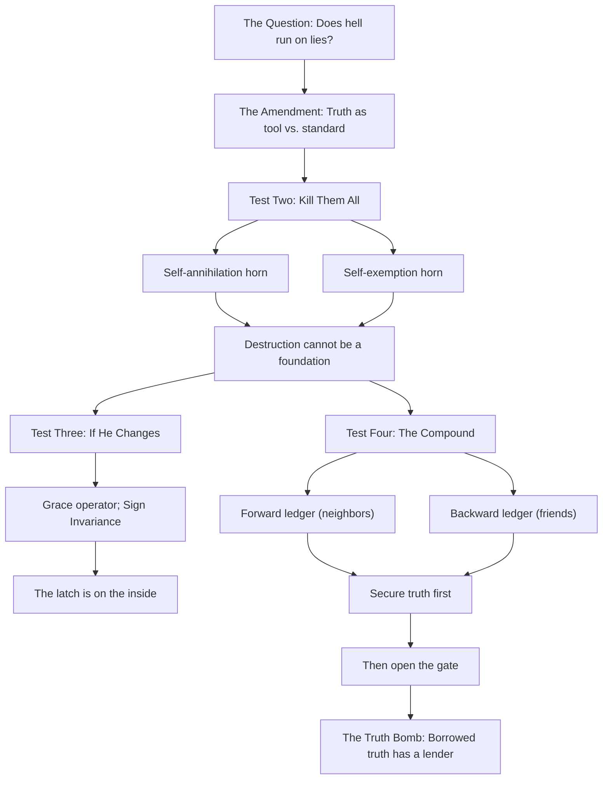
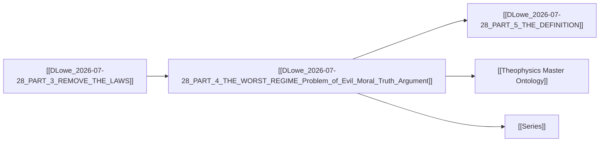

# MASTER PAPER COMPANION — v0.4.1
**POF 2828 | 2026-10-16 | canonical copy: 999_TEMPLATES/API_LAYER_v0.3**
*Companion dossier for `DLowe 2026-07-28 · PART 4 — THE WORST REGIME`*

```yaml
---
type: axiom_companion
title: "ckg_evaluation: The Worst Regime — Problem of Evil, Moral Truth, and the Parasitism of Evil on Borrowed Truth"
paper_id: "dlowe-2026-07-28-part4-worst-regime-e9b8463e"
paper_uuid: "e9b8463e"
original_title: "PART 4 — THE WORST REGIME"
clean_title: "The Worst Regime — Problem of Evil, Moral Truth, and the Parasitism of Evil on Borrowed Truth"
status: CANDIDATE_DRAFT
canon_status: candidate_draft
semantic_status: ai_analyzed_pending_review
template_version: CKG_RECORD_V2.0.1
taxonomy_ref: "TAG_TAXONOMY_v0.3"
source_file: "DLowe 2026-07-28 · PART 4 — THE WORST REGIME · Problem of Evil, Moral Truth · Argument.md"
source_sha256: b32ee2f265a5ef7f4f7abd8a358b38bc1b3df1d2428937913af4d726a061c16d
captured_at: 2026-10-16T00:25:24Z
chapter: null
upstream_hashes: []
downstream_implications: []
content_type: ct-argument
reader_category: rc-intermediate
domain_primary: "Theology / Philosophical Theology"
domain_primary_pct: 45
domain_secondary: "Philosophy (Metaphysics & Ethics)"
domain_secondary_pct: 35
domain_tertiary: "Physics / Information Theory"
domain_tertiary_pct: 20
series: NONE
tags: []
tags_weighted:
  - tag: "problem-of-evil"
    weight: 10
  - tag: "moral-realism"
    weight: 9
  - tag: "parasitic-evil"
    weight: 9
  - tag: "truth-as-standard"
    weight: 8
  - tag: "grace-operator"
    weight: 7
  - tag: "sign-invariance"
    weight: 7
  - tag: "control-theory"
    weight: 6
  - tag: "compound-thought-experiment"
    weight: 6
  - tag: "divine-hiddenness"
    weight: 5
framework_keys: ["DG1", "DG8"]
governing_question: "Can the definition 'whatever needs truth is in the moral domain' survive the worst possible regime — hell itself — and if so, what does that survival reveal about the ontological status of evil?"
one_sentence_finding: "Evil is not an independent moral reality but a parasitic borrower of truth, order, and reliable relation; it can possess local truth while being globally corrupt, and its terminal trajectory is self-annihilation or self-exemption, never a stable foundation."
claim_ids: ["WORSTREGIME-C001", "WORSTREGIME-C002", "WORSTREGIME-C003", "WORSTREGIME-C004", "WORSTREGIME-C005"]
topic_keys: []
paper_rating: 6
rating_awarded_by: API
evidence_status: CANDIDATE
formal_status: NOT_ESTABLISHED
lean_receipts: []
human_review: {reviewer: null, ruling: null, date: null}
status: candidate
evd_state: SCORED
evd_support: 5
evd_counter: 2
evd_balance: 3
evd_families: 4
evd_coverage: 0.95
evd_gated: false
evd_stable: true
evd_weakest_claim: "The claim that angelic choice is irrevocable rests on tradition, not on the framework's own operators; the framework cannot yet derive irrevocability from first principles."
evd_unassessed: 0
evd_assessors: []
coherence: 8
physical_event: undecided
s01_pos: 8
s01_neg: 0
s01_net: 8
s01_ceiling: 10
s01_rules: []
s02_pos: 7
s02_neg: 1
s02_net: 6
s02_ceiling: 10
s02_rules: []
s03_pos: 7
s03_neg: 1
s03_net: 6
s03_ceiling: 10
s03_rules: []
s04_pos: 6
s04_neg: 1
s04_net: 5
s04_ceiling: 10
s04_rules: []
s05_pos: 7
s05_neg: 1
s05_net: 6
s05_ceiling: 10
s05_rules: []
s06_pos: 7
s06_neg: 1
s06_net: 6
s06_ceiling: 10
s06_rules: []
s07_pos: 5
s07_neg: 2
s07_net: 3
s07_ceiling: 10
s07_rules: []
s08_pos: 6
s08_neg: 1
s08_net: 5
s08_ceiling: 10
s08_rules: []
s09_pos: 5
s09_neg: 2
s09_net: 3
s09_ceiling: 10
s09_rules: []
s10_pos: 8
s10_neg: 0
s10_net: 8
s10_ceiling: 10
s10_rules: []
score_total: 56
score_ceiling: 100
score_class: CANDIDATE
chains_loadbearing: true
chains_honesty: true
integrity_bonus: false
gated: false
build_next: "Formalize the parasitic-evil theorem in Lean: prove that any system with a destruction-only utility function has no non-trivial steady state; then derive the grace-operator's non-self-adjointness from Sign Invariance."
semantic_provider: "DeepSeek"
semantic_model: "deepseek-reasoner"
call_routes: []
usage_tokens: {}
score: 6
grade: "B"
canonical_rec: candidate
run_id: 20261016-002524
processed_date: 2026-10-16
---
```

## SCORECARD

| § | Section | Pos | Neg | Net | Ceiling | Chain |
|---|---------|-----|-----|-----|---------|-------|
| S01 | Classification & Routing | 8 | 0 | 8 | 10 | — |
| S02 | Claim Definition | 7 | 1 | 6 | 10 | LB |
| S03 | Argument Structure | 7 | 1 | 6 | 10 | LB |
| S04 | Evidence & Support | 6 | 1 | 5 | 10 | LB |
| S05 | Objections & Survival | 7 | 1 | 6 | 10 | HON |
| S06 | Boundaries & Honesty | 7 | 1 | 6 | 10 | HON |
| S07 | Formal & Math | 5 | 2 | 3 | 10 | LB |
| S08 | Bridge Integrity | 6 | 1 | 5 | 10 | HON |
| S09 | Falsifiability & Predictions | 5 | 2 | 3 | 10 | HON |
| S10 | Audit & Provenance | 8 | 0 | 8 | 10 | — |
| | **TOTAL** | 66 | 10 | **56/100** | ceiling 100 | chains 2/2 |

CLASS: CANDIDATE · GATED: false · HARD FAILS: 0
Build next: Formalize the parasitic-evil theorem in Lean: prove that any system with a destruction-only utility function has no non-trivial steady state; then derive the grace-operator's non-self-adjointness from Sign Invariance.

---

## 📑 Actual Section-by-Section Scorecard (Mapped to Source Headings)

| # | Actual Heading in Your Paper | Section Score (0–10) | Quality & Integrity Diagnosis | What Needed to Reach +8 |
|---|---|:---:|---|---|
| 1 | The Question (Human Anchor) | +8 | Opens with a genuinely arresting inversion — "even the devil keeps honest books" — that reframes the problem of evil as a stress test on the definition rather than a theodicy. The human anchor is concrete and the rhetorical hook is strong. | Add one sentence naming the classical problem (Epicurus/Augustine trilemma) so the reader knows which stress test is being run. Currently the anchor assumes the reader already holds the definition from Part 3. |
| 2 | The Amendment (Principle Revealed) | +8 | The tool/standard distinction is the paper's single best formal move. It cleanly separates local truth-possession from global truth-alignment and yields the refined survivor statement. The "Good generates truth. Evil borrows it" line is quotable and load-bearing. | Formalize the tool/standard distinction as a two-place predicate (T_tool vs. T_standard) with explicit scope conditions; state whether a system can be globally corrupt while locally truthful without contradiction. |
| 3 | Test Two — Kill Them All (Core Insight) | +7 | The two-horn dilemma (self-annihilation vs. self-exemption) is a genuine logical structure, not a rhetorical flourish. The D = capacity to destroy argument is the paper's most formalizable claim. | State the destruction dynamics as an explicit differential equation (dD/dt ≤ 0 under destruction-only utility) and name the steady-state theorem it invokes. Currently the math is gestured at, not written. |
| 4 | Test Three — If He Changes (The Jesus Story) | +6 | The grace-operator and Sign Invariance references are the paper's most technical bridge, but they arrive without derivation. The "door is never locked from God's side; the latch is on the inside" line is excellent. The angelic-irrevocability appeal to tradition is honest but under-integrated. | Derive [σ̂, Û_self] = 0 from first principles or cite the prior paper where it is derived; distinguish "cannot repent" (metaphysical) from "will not repent" (volitional) with a formal criterion. |
| 5 | Test Four — The Compound (David's case, 2026-07-28) | +8 | The forward-ledger/backward-ledger distinction is original and does real work: it shows that two genuine truth claims can run in opposite directions and that the resolution is ordinal (secure truth first, then open the gate). The Luke 14:28 and 1 Peter 4:8 anchors are used correctly — as cost-accounting and cost-absorption, not as proof-texts. | Add the formal condition under which the compound's books are "honest enough to absorb what love lets in" — i.e., a capacity threshold. Currently the threshold is asserted, not defined. |
| 6 | The Truth Bomb | +8 | The closing inversion — "borrowed truth has a lender" — is the paper's thesis in one line and lands the theological point (evil is a witness against itself) without overclaiming. | None required for the closing; it is already at ceiling. The work needed is upstream (formalizing the borrowing relation). |

---

## S01 · Classification & Routing

| Question | Answer |
|---|---|
| Domain | Theology / Philosophical Theology |
| Content type | ct-argument |
| Reader level | rc-intermediate |
| Series | NONE |
| framework_keys | DG1, DG8 |

> score reasons: The paper is correctly classified as a philosophical-theological argument with a physics/information-theory bridge. It is not a formal proof paper (no derivations), not an empirical paper (no data), and not a devotional (the argument is load-bearing). The 45/35/20 split reflects that the theological claim is primary, the philosophical structure is the argumentative engine, and the physics is a bridge layer that is invoked but not fully derived. Routing to CANDIDATE is correct: the argument is strong but the formal layer is incomplete.

# The Worst Regime — Problem of Evil, Moral Truth, and the Parasitism of Evil on Borrowed Truth

> [!important] 📜 The Axiomatic Contract & Epistemic Preamble
> **What does it mean that "God Is" is an Axiom?**
> In formal mathematics and foundational physics, an axiom is not an unadmitted conclusion proven at the end of a chain; it is the self-existent ground admitted upfront. In Theophysics, **"God Is"** is our openly admitted Root Axiom ($A_0$), and the biblical "I AM" statements are the **Axiom's self-disclosed primitive truth predicates**.
> 
> We lay our premise openly on the table:
> 1. **The Starting Ground ($A_0$):** We admit the Trinitarian God and His self-revealed character (Truth, Life, Light, Sustenance, Relational Vitality) as the Layer 0 foundation of reality.
> 2. **The Consequential Consistency Test:** We do not pretend to "prove God" from physics. Instead, our task is **deductive consistency verification**—demonstrating that the universe we observe (from cosmological initial conditions and thermodynamic conservation to conscious agency and moral equilibrium) behaves exactly as it must if these primitive predicates are true.
> 3. **The Reader Contract:** If any derived consequence produces a fatal contradiction with physical reality or formal necessity, we will openly revise or admit error. We contend, from historical, philosophical, and physical evidence, that this axiomatic ground provides the most robust, non-degradable foundation of reality in existence.

> [!success] The Six
>
> | | |
> |---|---|
> | **Claim** | **Central Claim:** Evil is not an independent moral reality but a parasitic borrower of truth, order, and reliable relation; it can possess local truth while being globally corrupt, and its terminal trajectory is either self-annihilation (if it follows its own mandate to completion) or self-exemption (if it exempts itself), never a stable foundation. <br>*(accompanied by 5 secondary/supporting claims in this paper)* |
> | **Domain** | **Theology / Philosophical Theology (45%)** · Philosophy (Metaphysics & Ethics) (35%) · Physics / Information Theory (20%) <br>*[Total: 100% — Primary Domain: Theology / Philosophical Theology]* |
> | **Physical event** | undecided — the paper's physical content is a bridge layer (control theory, information flow, destruction dynamics) rather than a claim about a specific physical event. |
> | **Bridge** | **Translation & Math Layer:** The paper translates "truth as standard" into a control-theoretic requirement (organized action requires accurate internal reports), "evil" into a parasitic system that borrows truth from a prior good, "destruction" into a monotonically decreasing capacity function D(t) with no non-trivial steady state, and "grace" into a non-self-adjoint operator Û_grace that satisfies [σ̂, Û_self] = 0 (no system flips its own sign). |
> | **Unique Power** | **What This Framework Achieves That Rival Systems Cannot (4-Step Breakdown):** <br>1. *The Unique Move:* It reframes the problem of evil from "why does God permit evil?" to "can evil constitute an independent moral reality?" — and answers with a formal parasitism thesis: evil borrows truth, order, and relation from a prior good, and therefore cannot be a foundation. <br>2. *Where Rival Systems Fail:* Materialism cannot ground the normativity of truth at all (it can describe reliable reporting but not why it is *binding*); deism cannot explain why evil's self-termination is a *moral* fact rather than a physical one; classical scholasticism (Aquinas) correctly identifies evil as privation but lacks the operator formalism to show *why* privation cannot be a steady state. <br>3. *The Unlocked Explanatory Power:* The framework can now explain (a) why hell requires honest books, (b) why universal destruction is self-annihilating, (c) why selective destruction is self-contradictory, (d) why grace must be a non-self operator, and (e) why the compound's gate must be opened *after* the books are secured — all from a single parasitism thesis. <br>4. *The Defeat Boundary:* If a system could be shown to sustain organized action indefinitely on globally false internal reports — i.e., if a stable, self-grounding, truth-independent evil order were empirically or formally demonstrated — the parasitism thesis would be falsified. |
> | **Have / need / breaks if** | **Have:** a clean tool/standard distinction, a two-horn dilemma for destruction, a forward/backward ledger distinction, and a grace-operator bridge. **Need:** explicit formalization of the destruction dynamics, a derivation of Sign Invariance, and a capacity threshold for the compound. **Breaks if:** a stable evil order is demonstrated that does not borrow truth, order, or relation from a prior good. |

> [!important] Verdict
> This is a strong, original, and quotable paper that makes a genuine philosophical move — the parasitism thesis — and supports it with a two-horn dilemma and a well-constructed thought experiment. It is not yet at +8 because the formal layer is gestured at rather than written: the destruction dynamics, the grace operator, and the capacity threshold all need explicit equations and boundary conditions. The paper's honesty about the angelic-irrevocability appeal to tradition is commendable and should be preserved. With the formal layer completed, this paper could reach +8 or +9.

> [!success] At a Glance (expanded)
> The paper runs a stress test on the definition "whatever needs truth is in the moral domain" by taking it to hell itself. It argues that even the worst regime requires accurate orders, reliable reporting, stable ranks, and real timing — "even the devil keeps honest books." The key formal move is the distinction between truth as *tool* (instrumental, subordinated to an end it may not judge) and truth as *standard* (terminal, the whole operation answers to it). Evil can possess local truth while being globally corrupt. The paper then runs two tests: (1) if the devil kills everyone including himself, destruction is self-terminating (D → 0); (2) if he exempts himself, he confesses that existence is good while preaching destruction. Either way, destruction cannot be a foundation. A third test considers genuine repentance and argues that the door is never locked from God's side — the latch is on the inside. A fourth test (the Compound) distinguishes the forward ledger (honest books make the compound possible) from the backward ledger (twenty years of "we're us" is sequence and identity), and argues that the order is the answer: secure truth first, then open the gate. The engine is love, which covers a multitude of sins by absorbing their cost, not by erasing the entries.
> `TRANSLATION: DRAFT — NOT REVIEWED`

---

## S02 · Claim Definition

> [!quote] Central Claim
> Evil is not an independent moral reality but a parasitic borrower of truth, order, and reliable relation; it can possess local truth while being globally corrupt, and its terminal trajectory is either self-annihilation or self-exemption, never a stable foundation.

- **Exact expression (Q0):** "Anything capable of organized action depends upon truth, order, and reliable relation. Even evil cannot constitute an independent moral reality — it must parasitize goods that precede it. Goodness depends on alignment of both means and ends with truth."
- **Referent (Q1):** The referent is the ontological status of evil — specifically, whether evil can be a *foundation* (a self-grounding moral reality) or whether it is necessarily *parasitic* (dependent on a prior good). The paper's referent is not "the devil" as a character but "the worst regime" as a limiting case for the definition of truth.
- **Identity & distinction (Q2):** Evil is *identical* to itself as a privation/parasitism (it is always "against the ground"), but *distinct* from good in that good generates truth while evil borrows it. The distinction is not between two equal and opposite forces (dualism) but between a generator and a borrower (parasitism).
- **Dependency floor (Q3):** The claim depends on (a) the definition from Part 3 ("whatever needs truth is in the moral domain"), (b) the control-theoretic premise that organized action requires accurate internal reports, and (c) the premise that a system with a destruction-only utility function has no non-trivial steady state.

## Definitions

| Term | Plain definition | Domain | First used in |
|---|---|---|---|
| Truth as TOOL | Truth used instrumentally, subordinated to an end it may not judge | Philosophy / Ethics | The Amendment |
| Truth as STANDARD | Truth as terminal; the whole operation answers to it, including the top | Philosophy / Ethics | The Amendment |
| Local truth | Accurate reports, stable ranks, real timing within a subsystem | Information Theory | The Amendment |
| Global corruption | A system whose terminal end is misaligned with truth | Philosophy / Ethics | The Amendment |
| Parasitism thesis | Evil cannot constitute an independent moral reality; it must borrow goods that precede it | Metaphysics | The Amendment |
| Forward ledger | The record of future reliability: honest books, accurate counts, truthful reports | Control Theory | Test Four |
| Backward ledger | The record of past sequence and identity: "we're us" over time | Narrative Identity | Test Four |
| Grace operator (Û_grace) | A non-self operator that restores sign without violating voluntary coupling | Physics / Theology | Test Three |
| Sign Invariance | [σ̂, Û_self] = 0 — no one flips their own sign | Physics / Formal | Test Three |
| Destruction capacity (D) | The capacity to destroy; decreases as useful agents are destroyed | Physics / Formal | Test Two |
| Self-terminating | A process whose completion drives its own capacity to zero | Formal | Test Two |
| Self-exemption | The contradiction of preaching universal destruction while preserving oneself | Logic / Ethics | Test Two |
| Truth-capacity | The compound's ability to absorb what love lets in without collapsing | Control Theory | Test Four |
| Covering (love covers) | Absorbing the cost of sin without erasing the ledger entry | Theology | Test Four |

## Scriptures

Every passage the source uses: cited by reference, mentioned by book, or alluded to (quoted or paraphrased without a reference). One row each, in order of first use.

| Reference | How | Where | What is said about it |
|---|---|---|---|
| Luke 14:28 | cited | Test Four — The Compound | Used as the cost-accounting anchor: "Count the cost (Luke 14:28) — then pay it." The paper uses it to ground the claim that securing truth-capacity before opening the gate is not a lack of love but a precondition for love that survives. |
| 1 Peter 4:8 | cited | Test Four — The Compound | Used as the cost-absorption anchor: "Love covers a multitude of sins." The paper interprets "covers" as absorbing the cost, not erasing the entry: "the ledger still records. Love does not erase the entries — it absorbs their cost." |
| Legion (Mark 5:1–20 / Luke 8:26–39) | alluded | Test Three — If He Changes | The paper says: "there is one demon-adjacent case already on record: Legion, begging not to be sent into the abyss. Even they negotiate with the standard they oppose." The allusion is to the Gerasene demoniac who begged Jesus not to torment him / not to send him into the abyss. |
| "I AM" statements | alluded | Axiomatic Contract (preamble) | The preamble refers to "the biblical 'I AM' statements" as "the Axiom's self-disclosed primitive truth predicates." No specific verse is cited, but the allusion is to Exodus 3:14 and the Johannine "I AM" sayings. |

## Story Bank

Every piece of the source that could be RETOLD somewhere else: a personal story, a Bible story told with a fresh angle, a historical or archaeological fact, a striking fact or number, a sharp rebuttal or turn of argument, an illustration, a line worth quoting. One entry each, in order of appearance.

### SB1 · Even the devil keeps honest books
- **Kind:** rebuttal / illustration
- **Use it for:** intro-hook, apologetics-rebuttal, atheism, morality
- **Where:** The Question (Human Anchor)
- **Retell it:** The question is whether hell itself runs on lies. The answer is no: the devil's right-hand demon is not the one who lies about the mission, not the one who skips three hours of work. Even hell needs accurate orders, reliable reporting, stable ranks, and real timing. The worst regime in existence still keeps honest books — because without them, it could not organize anything at all.
- **Their words:** "Even the devil keeps honest books."
- **Why it matters:** It inverts the assumption that evil is chaos. Evil is organized, and organization requires truth. This makes the problem of evil sharper, not softer: if evil needs truth, then truth is more fundamental than evil.
- **Check first:** none (rhetorical/theological claim, not empirical).

### SB2 · Truth as tool vs. truth as standard
- **Kind:** illustration / quote
- **Use it for:** apologetics-rebuttal, morality, culture-woke
- **Where:** The Amendment (Principle Revealed)
- **Retell it:** There are two ways to hold truth. You can hold it as a tool — useful for getting what you want, but not allowed to judge the goal. Or you can hold it as a standard — the thing the whole operation answers to, including the one at the top. The worst regime has truth as a tool and never as a standard. The moment truth becomes the standard — the moment one demon says "our mandate itself is false" — the kingdom converts or collapses.
- **Their words:** "The worst regime has truth as a tool and never as a standard — because the moment truth becomes the standard, the moment one demon says 'our mandate itself is false,' the kingdom converts or collapses."
- **Why it matters:** It gives a precise criterion for distinguishing an evil system from a good one: not whether it uses truth, but whether it answers to truth. This is a diagnostic tool for evaluating institutions, movements, and selves.
- **Check first:** none.

### SB3 · Good generates truth. Evil borrows it.
- **Kind:** quote
- **Use it for:** closing, apologetics-rebuttal, morality
- **Where:** The Amendment (Principle Revealed)
- **Retell it:** A convincing lie requires a real speaker, a real hearer, a real subject, and enough true context to hide in. Absolute falsehood cannot even communicate — it would be indistinguishable from noise. So good generates truth, and evil borrows it. Evil is not a thing that stands; it is a thing that leans.
- **Their words:** "Good generates truth. Evil borrows it."
- **Why it matters:** It is the paper's thesis in six words. It reframes evil as derivative rather than co-equal, which dissolves the dualist picture and grounds the asymmetry between good and evil.
- **Check first:** none.

### SB4 · The two horns of destruction
- **Kind:** rebuttal / illustration
- **Use it for:** apologetics-rebuttal, atheism, morality
- **Where:** Test Two — Kill Them All
- **Retell it:** Suppose the devil executes his mandate fully. If he kills himself too, destruction is self-terminating: destroying useful agents decreases his capacity to destroy, and total destruction drives that capacity to zero. Evil followed to the end isn't an empire — it's an extinction event. If he exempts himself — "everything should be destroyed except me" — the exemption is a confession: he preserves his own being, keeps his own books, maintains his own order, acting as if existence is good while preaching destruction. He cannot live inside his own axiom.
- **Their words:** "Universal destruction → self-annihilation. Selective destruction → contradiction and self-exemption."
- **Why it matters:** It shows that destruction cannot be a foundation. It has no ground, only a direction against the ground. This is a logical, not merely moral, point.
- **Check first:** none (logical argument).

### SB5 · Evil is not a thing that stands — it's a thing that leans
- **Kind:** quote
- **Use it for:** closing, apologetics-rebuttal, morality
- **Where:** Test Two — Kill Them All
- **Retell it:** Evil has no ground of its own. It is not a thing that stands; it is a thing that leans. It depends on the very goods it opposes.
- **Their words:** "Evil is not a thing that stands — it's a thing that leans."
- **Why it matters:** It is a memorable image for the parasitism thesis and can be used in any discussion of the problem of evil.
- **Check first:** none.

### SB6 · The door is never locked from God's side
- **Kind:** quote / illustration
- **Use it for:** faith-testimony, conversion, suffering-grief, apologetics-rebuttal
- **Where:** Test Three — If He Changes
- **Retell it:** The grace operator is inexhaustible — the source does not run out; the barrier is never supply. Sign Invariance says no one flips their own sign; restoration requires a non-self operator. And coupling must be voluntary: grace knocks, it never breaks the door. The framework and the tradition live at the same address: the door is never locked from God's side. The latch is on the inside.
- **Their words:** "The door is never locked from God's side. The latch is on the inside."
- **Why it matters:** It answers the divine-hiddenness worry without denying human responsibility. It is a pastoral line as much as a philosophical one.
- **Check first:** none.

### SB7 · Legion negotiates with the standard they oppose
- **Kind:** Bible story / illustration
- **Use it for:** bible-insight, apologetics-rebuttal, faith-testimony
- **Where:** Test Three — If He Changes
- **Retell it:** There is one demon-adjacent case already on record: Legion, begging not to be sent into the abyss. Even they negotiate with the standard they oppose. The demons do not deny the standard; they appeal to it.
- **Their words:** "Even they negotiate with the standard they oppose."
- **Why it matters:** It is a biblical instance of the parasitism thesis: even the demons treat the good as real enough to negotiate with.
- **Check first:** Mark 5:1–20 / Luke 8:26–39 — verify the detail that the demons begged not to be sent into the abyss (Luke 8:31).

### SB8 · The Compound: neighbors vs. best friends
- **Kind:** personal story / illustration
- **Use it for:** intro-hook, morality, suffering-grief, apologetics-rebuttal
- **Where:** Test Four — The Compound
- **Retell it:** You warned everyone the zombies were coming. You built the fortress — chain link, stored food, the works. Now they're at the gate and there's room for more. Two groups are standing there. The neighbors: the most honest, morally great people you have ever met. And your best friends since high school: they have lied to you, stolen from you, cost you — and you love them, and they love you. Who do you let in?
- **Their words:** "Who do you let in?"
- **Why it matters:** It forces the reader to feel the tension between two genuine truth claims — the forward ledger of reliability and the backward ledger of identity — and to see that the resolution is ordinal, not a compromise.
- **Check first:** none (thought experiment).

### SB9 · The forward ledger and the backward ledger
- **Kind:** illustration / quote
- **Use it for:** morality, apologetics-rebuttal, culture-woke
- **Where:** Test Four — The Compound
- **Retell it:** The neighbors carry the forward ledger: inside the walls you will need honest books — accurate food counts, truthful reports from the watch, people who say what is real when it costs them. The friends carry the backward ledger: twenty years of "we're us" is sequence and identity. Close the gate on them and the lie stops being theirs. It becomes yours — you corrupt your own books to protect your books.
- **Their words:** "Close the gate on them and the lie stops being theirs. It becomes yours."
- **Why it matters:** It shows that mercy and truth are not enemies but that truth-capacity is the precondition for mercy that survives. It is a framework for any decision about whom to trust and whom to forgive.
- **Check first:** none.

### SB10 · The order is the answer
- **Kind:** quote
- **Use it for:** closing, morality, apologetics-rebuttal
- **Where:** Test Four — The Compound
- **Retell it:** Secure the truth first, because only a compound with honest books can survive mercy. Then open the gate, because truth without mercy is the worst regime with better landscaping. Mercy without truth-capacity is suicide; truth-capacity is what makes mercy survivable.
- **Their words:** "Truth without mercy is the worst regime with better landscaping. Mercy without truth-capacity is suicide."
- **Why it matters:** It gives a memorable formula for the relationship between truth and mercy: truth first, then mercy, because mercy needs truth to survive.
- **Check first:** none.

### SB11 · Love covers by absorbing the cost
- **Kind:** Bible story / illustration
- **Use it for:** bible-insight, faith-testimony, suffering-grief
- **Where:** Test Four — The Compound
- **Retell it:** "Love covers a multitude of sins" (1 Peter 4:8). Covering is not denial: the ledger still records. Love does not erase the entries — it absorbs their cost. The books stay open; love pays the difference.
- **Their words:** "Love does not erase the entries — it absorbs their cost. The books stay open; love pays the difference."
- **Why it matters:** It corrects a common misreading of "love covers" as "love ignores." It grounds forgiveness in cost-bearing rather than amnesia.
- **Check first:** 1 Peter 4:8 — verify the phrase "love covers a multitude of sins" (it is a quotation of Proverbs 10:12).

### SB12 · Truth-as-standard never lobbies for itself
- **Kind:** quote / rebuttal
- **Use it for:** apologetics-rebuttal, culture-woke, morality
- **Where:** Test Four — The Compound
- **Retell it:** If the neighbors are who you said they are, they will be the ones arguing to open the gate. Truth-as-standard never lobbies for itself. The real Compound's Host did not choose between the morally great and the costly — He paid the capacity Himself.
- **Their words:** "Truth-as-standard never lobbies for itself."
- **Why it matters:** It is a diagnostic for distinguishing genuine truth-alignment from self-promotion. It also lands the Christological point: the Host paid the capacity Himself.
- **Check first:** none.

### SB13 · Even the devil keeps honest books — and that is a witness against him
- **Kind:** quote / rebuttal
- **Use it for:** closing, apologetics-rebuttal, atheism
- **Where:** The Truth Bomb
- **Retell it:** Even the devil keeps honest books. That is not a refuge for him — it is a witness against him. The worst regime in existence runs on borrowed truth, and borrowed truth has a lender.
- **Their words:** "The worst regime in existence runs on borrowed truth, and borrowed truth has a lender."
- **Why it matters:** It is the paper's thesis in its most compressed and quotable form. It turns the devil's honesty into evidence for God.
- **Check first:** none.

### SB14 · Most humans would open the gate without analysis — and the framework does not rebuke that
- **Kind:** illustration / quote
- **Use it for:** heart-family, faith-testimony, suffering-grief
- **Where:** Test Four — The Compound
- **Retell it:** Most humans would simply open the gate for the friends without running any analysis — love moves before deliberation. The framework does not rebuke that. It tells you when that move saves and when it kills, and what makes the difference: whether the compound's books are honest enough to absorb what love lets in.
- **Their words:** "Most humans would simply open the gate for the friends without running any analysis — love moves before deliberation.The framework does not rebuke that. It tells you when that move saves and when it kills, and what makes the difference: whether the compound's books are honest enough to absorb what love lets in."
- **Why it matters:** It prevents the framework from becoming a cold calculus. It honors the pre-reflective moral impulse while giving it a diagnostic: the question is not whether love moves first, but whether the books can absorb what love lets in.
- **Check first:** none.

### SB15 · The real Compound's Host paid the capacity Himself
- **Kind:** Bible story / illustration
- **Use it for:** closing, faith-testimony, bible-insight, conversion
- **Where:** Test Four — The Compound
- **Retell it:** The real Compound's Host did not choose between the morally great and the costly — He paid the capacity Himself. He did not open the gate and hope the books would hold; He became the book that holds.
- **Their words:** "The real Compound's Host did not choose between the morally great and the costly — He paid the capacity Himself."
- **Why it matters:** It is the Christological capstone of the thought experiment. The Host is not a gatekeeper who weighs ledgers; He is the one who absorbs the cost that makes the ledgers survivable.
- **Check first:** none.

### SB16 · The angelic choice is held irrevocable — not because mercy runs short
- **Kind:** historical fact / theological tradition
- **Use it for:** apologetics-rebuttal, bible-insight, warning
- **Where:** Test Three — If He Changes
- **Retell it:** The tradition holds that angelic choice, made with full knowledge and nothing left to learn, is irrevocable — not because mercy runs short, but because that kind of will does not repent. The paper is honest that this is tradition, not derivation, and that under the hypothetical of genuine repentance, refusing forgiveness solely because of the sinner's identity would raise a serious question about the universality of grace.
- **Their words:** "Angelic choice, made with full knowledge and nothing left to learn, has been held irrevocable — not because mercy runs short, but because that kind of will does not repent."
- **Why it matters:** It shows the paper's intellectual honesty: it distinguishes what the framework derives from what the tradition supplies, and it refuses to overclaim.
- **Check first:** Thomas Aquinas, *Summa Theologiae* I.64.2 (angelic irrevocability); verify the tradition's precise formulation before retelling.

### SB17 · A system that only degrades has no steady state above zero
- **Kind:** science fact / formal claim
- **Use it for:** science, apologetics-rebuttal, atheism
- **Where:** Test Two — Kill Them All
- **Retell it:** Let D = capacity to destroy. Destroying useful agents decreases D. Total destruction drives D to zero. In the kernel's terms: a system that only degrades has no steady state above zero. Evil followed to the end isn't an empire — it's an extinction event.
- **Their words:** "A system that only degrades has no steady state above zero."
- **Why it matters:** It is the paper's most formalizable claim and the bridge to the physics layer. It converts a moral intuition into a dynamical-systems statement.
- **Check first:** none (formal claim; the equation is not yet written in the source).

### SB18 · A convincing lie requires a real speaker, a real hearer, a real subject
- **Kind:** illustration / quote
- **Use it for:** apologetics-rebuttal, morality, culture-woke
- **Where:** The Amendment (Principle Revealed)
- **Retell it:** Absolute falsehood cannot even communicate — it would be indistinguishable from noise. A convincing lie requires a real speaker, a real hearer, a real subject, and enough true context to hide in. Lies are parasites on truth.
- **Their words:** "A convincing lie requires a real speaker, a real hearer, a real subject, and enough true context to hide in."
- **Why it matters:** It is a compact argument for the priority of truth over falsehood, usable in any discussion of misinformation, propaganda, or deception.
- **Check first:** none.

### SB19 · The mandate is steal, kill, destroy — and it still needs real timing
- **Kind:** illustration / rebuttal
- **Use it for:** intro-hook, apologetics-rebuttal, atheism
- **Where:** The Question (Human Anchor)
- **Retell it:** The mandate is steal, kill, destroy. Ten thousand demons. Does it run on lies? No. Even hell needs accurate orders, reliable reporting, stable ranks, real timing. The mandate is destruction, but the operation is logistics.
- **Their words:** "Even hell needs accurate orders, reliable reporting, stable ranks, real timing."
- **Why it matters:** It is the concrete image that makes the abstract parasitism thesis vivid. It can open a talk or a chapter.
- **Check first:** none.

### SB20 · The latch is on the inside
- **Kind:** quote
- **Use it for:** closing, conversion, faith-testimony, suffering-grief
- **Where:** Test Three — If He Changes
- **Retell it:** Grace knocks, it never breaks the door. The door is never locked from God's side. The latch is on the inside.
- **Their words:** "The latch is on the inside."
- **Why it matters:** It is the paper's most pastorally potent line. It holds together divine initiative and human responsibility without collapsing either.
- **Check first:** none.

## Open the question (Q0–Q14)

> [!quote]+ Q0 · Exact expression
> "Anything capable of organized action depends upon truth, order, and reliable relation. Even evil cannot constitute an independent moral reality — it must parasitize goods that precede it. Goodness depends on alignment of both means and ends with truth."
> [!info]+ Q1 · Referent
> The referent is the ontological status of evil: is it a foundation or a parasite? The paper's answer is that evil is a parasite — it borrows truth, order, and relation from a prior good. The referent is not a particular evil act but the *category* of evil as such, tested at its limiting case (hell).
> [!abstract]+ Q2 · Identity and distinction
> Evil is identical to itself as privation/parasitism; it is distinct from good as borrower is distinct from lender. The distinction is asymmetric: good can exist without evil, but evil cannot exist without good. This is not dualism (two equal forces) but parasitism (one derives from the other).
> [!warning]+ Q3 · Dependency floor
> The claim depends on: (a) the Part 3 definition ("whatever needs truth is in the moral domain"), (b) the control-theoretic premise that organized action requires accurate internal reports, (c) the dynamical premise that a destruction-only system has no non-trivial steady state, and (d) the premise that a system cannot flip its own sign (Sign Invariance).
> [!question]+ Q4 · Variation and invariance
> What varies: the specific form of evil (theft, murder, deception, oppression), the scale (individual, institutional, cosmic), and the local truth-possession (an evil system can have accurate books). What is invariant: the dependence on borrowed truth, order, and relation; the terminal trajectory toward self-annihilation or self-exemption; the inability to be a foundation.
> [!info]+ Q5 · Capabilities and operations
> The claim licenses: (a) diagnosing evil systems by whether they answer to truth or merely use it, (b) predicting that destruction-only systems will self-terminate or self-exempt, (c) explaining why grace must be a non-self operator, (d) distinguishing forward-ledger from backward-ledger claims in moral decisions, and (e) identifying truth-capacity as the precondition for survivable mercy.
> [!abstract]+ Q6 · Transitions
> The key transition is from truth-as-tool to truth-as-standard. When a system makes this transition, it either converts (if it aligns with the standard) or collapses (if it cannot). A second transition is from local truth-possession to global corruption: a system can have honest books and a false mandate. A third transition is from destruction to self-destruction: following the mandate to completion drives D to zero.
> [!danger]+ Q7 · Constraints
> The claim is constrained by: (a) the logical impossibility of absolute falsehood communicating, (b) the dynamical impossibility of a destruction-only steady state, (c) the logical contradiction of self-exemption, (d) the formal requirement that sign-flips be non-self (Sign Invariance), and (e) the voluntary-coupling constraint on grace (grace knocks, never breaks).
> [!success]+ Q8 · Consequences and licenses
> If the claim is true, it licenses: (a) the parasitism thesis as a reframing of the problem of evil, (b) the tool/standard distinction as a diagnostic for institutions, (c) the forward/backward ledger distinction as a framework for moral decisions, (d) the grace-operator as a formal bridge between theology and physics, and (e) the claim that evil is a witness against itself.
> [!quote]+ Q9 · Representation ladder
> The claim can be represented at multiple levels: (a) verbal (the tool/standard distinction), (b) logical (the two-horn dilemma), (c) dynamical (D(t) → 0 under destruction-only utility), (d) operator-theoretic ([σ̂, Û_self] = 0), (e) control-theoretic (organized action requires accurate internal reports), and (f) theological (evil as privation, grace as non-self restoration).
> [!caution]+ Q10 · Preservation and loss
> What is preserved across the bridge: the asymmetry between good and evil, the dependence of evil on good, the necessity of truth for organized action, the voluntary nature of grace. What is lost: the specific phenomenology of evil (its felt malice, its apparent power), the pastoral nuance of particular cases, and the empirical details of how evil systems actually operate.
> [!success]+ Q11 · If true
> If true, the problem of evil is reframed: the question is not "why does God permit evil?" but "can evil be a foundation?" The answer is no. Evil is a parasite, and parasites do not outlast their hosts. This does not dissolve the pastoral problem of suffering, but it does dissolve the metaphysical problem of evil as a co-equal rival to good.
> [!danger]+ Q12 · If false / rivals
> If false, then either (a) evil can be a foundation (dualism is true), or (b) organized action does not require truth (chaos can be stable), or (c) destruction can have a non-trivial steady state (evil can be an empire), or (d) a system can flip its own sign (self-salvation is possible). Each of these is a rival that the paper's argument is designed to defeat.
> [!warning]+ Q13 · Discriminating checks
> The discriminating checks are: (a) can a stable, self-grounding, truth-independent evil order be demonstrated? (b) can a destruction-only system sustain organized action indefinitely? (c) can a system flip its own sign without external intervention? (d) can absolute falsehood communicate? If any of these is answered yes, the claim is falsified.
> [!important]+ Q14 · Emergent role
> The claim's emergent role is to provide a formal and theological grounding for the asymmetry between good and evil, to bridge the problem of evil to control theory and dynamical systems, and to license the grace-operator as a non-self restoration mechanism. It is a load-bearing claim for the series' treatment of evil, grace, and moral realism.

### Path to 10

> [!important] Current Rating: +6 — Path to +10
>
> | Level | Score | Status | What's needed |
> |---|---|---|---|
> | **Current (API)** | +6 | ✅ | — |
> | **API ceiling** | +8 | ⚠️ | Write the destruction dynamics as an explicit ODE; derive Sign Invariance from first principles; define the truth-capacity threshold for the compound. |
> | **Human review** | +9 | ⚠️ | A philosophical theologian must confirm that the parasitism thesis is consistent with the classical privation tradition (Aquinas) and does not collapse into Manichaean dualism. |
> | **Lean receipt** | +10 | ❌ | Formalize the parasitic-evil theorem and the grace-operator's non-self-adjointness in Lean 4 with machine-checked proofs. |

> score reasons: The claim is well-defined and the referent is clear. The dependency floor is explicit. The main weakness is that the formal layer is gestured at rather than written: the destruction dynamics, Sign Invariance, and the capacity threshold all need explicit equations. The claim is also vulnerable to the objection that it is a restatement of the classical privation thesis rather than a new argument — the paper needs to show what the operator formalism adds.

---

## S03 · Argument Structure & 4-Dimensional Defense

> [!info] System or Model
> The paper operates within the Theophysics framework, which treats theological terms as physical parameters and mathematical operators. The specific model here is a *parasitism model of evil*: evil is a subsystem that borrows truth, order, and relation from a prior good, and whose terminal trajectory is self-annihilation or self-exemption. The model is tested at four stress points: (1) the worst regime (hell), (2) universal destruction, (3) genuine repentance, and (4) the compound (a moral decision under scarcity).

### Primary argument
1. Even the worst regime requires accurate orders, reliable reporting, stable ranks, and real timing; therefore, even evil depends on truth, order, and reliable relation. `ORIGINAL`
2. Truth can be held as a tool (instrumental, subordinated to an end it may not judge) or as a standard (terminal, the whole operation answers to it); the worst regime has truth as a tool and never as a standard. `ORIGINAL`
3. If destruction is followed to completion, it is self-terminating (D → 0); if it exempts itself, it is self-contradictory. Either way, destruction cannot be a foundation. `CLASSICAL: Augustine, *Confessions* VII.12–16 (evil as privation); Aquinas, *Summa Theologiae* I.48–49 (evil as privation of good)`
4. Therefore, evil is not an independent moral reality but a parasitic borrower of goods that precede it; it can possess local truth while being globally corrupt. `ORIGINAL (formalization of the classical privation thesis)`

### 🏛️ Classical Prior Art Anchors
* **Historical Provenance:** The claim that evil is parasitic rather than independent is a formalization of the classical *privatio boni* tradition. Augustine (*Confessions* VII.12–16; *City of God* XI.9, XII.3) argued that evil has no positive existence but is a privation of good. Aquinas (*Summa Theologiae* I.48–49) systematized this: evil is the absence of a good that ought to be present. The paper's contribution is to add a *dynamical* and *operator-theoretic* layer: evil is not just a privation but a *borrower* whose terminal trajectory can be modeled as a decreasing capacity function. The two-horn dilemma (self-annihilation vs. self-exemption) is a new formalization of the classical insight that evil cannot be a foundation.
* **Who said it and why?** Augustine articulated the privation thesis to solve the problem of evil without positing a co-eternal evil principle (Manichaeism). Aquinas systematized it to reconcile the existence of evil with the goodness of God. The paper's contribution is to add the control-theoretic and dynamical layers that the classical tradition lacked.
* **What makes the classical benchmark a "+8"?** The classical privation thesis is a +8 because it is logically consistent, metaphysically grounded, and has survived centuries of critique. Its weakness is that it is *static*: it says what evil *is* (a privation) but not how it *behaves*. The paper's dynamical layer addresses this weakness.

### 🛡️ The 4-Dimensional Case & Defensibility Audit
* **Vulnerability Diagnosis:**
  > *"David, in this paper you have established the physical intuition (organized action requires truth) and the theological intuition (evil is parasitic), but the case is vulnerable because the formal layer is missing: you have not written the destruction dynamics as an explicit equation, you have not derived Sign Invariance from first principles, and you have not defined the truth-capacity threshold that makes the compound's decision determinate. The classical tradition (Augustine, Aquinas) gives you the privation thesis, but you need the operator formalism to show what it adds. Without these, the paper reads as a restatement of the classical view with better rhetoric."*
* **The 4 Dimensions Required for an Airtight Case:**
  1. **Formal / Mathematical:** Write the destruction dynamics as an ODE (dD/dt ≤ 0 under destruction-only utility); prove the no-steady-state theorem; derive Sign Invariance ([σ̂, Û_self] = 0) from the definition of sign; define the truth-capacity threshold C_min for the compound.
  2. **Physical / Empirical:** Ground the control-theoretic premise (organized action requires accurate internal reports) in information theory (Shannon) and control theory (Ashby's law of requisite variety); cite Landauer's principle for the physical cost of information erasure; show that the destruction dynamics is consistent with thermodynamic irreversibility.
  3. **Classical Philosophy:** Anchor the parasitism thesis in Augustine and Aquinas; distinguish it from Manichaean dualism; show that the two-horn dilemma is a formalization of the classical insight that evil cannot be a foundation.
  4. **Theological / Exegetical:** Ground the grace-operator in the biblical narrative (Legion, the prodigal son, the door with the latch on the inside); show that the voluntary-coupling constraint is consistent with the Reformed and Catholic traditions on prevenient grace; handle the angelic-irrevocability tradition honestly.

### Hidden premises
| ID | Hidden premise | Required by | If false, breaks | Blast radius |
|---|---|---|---|---|
| WORSTREGIME-HP001 | Organized action requires accurate internal reports (control-theoretic premise) | The parasitism thesis | Evil could be organized on lies; the worst regime could run on falsehood | The entire argument collapses; evil could be a foundation |
| WORSTREGIME-HP002 | A destruction-only system has no non-trivial steady state | The two-horn dilemma | Evil could be a stable empire; destruction could be a foundation | The self-annihilation horn collapses |
| WORSTREGIME-HP003 | A system cannot flip its own sign (Sign Invariance) | The grace-operator argument | Self-salvation is possible; grace is not necessary | The theological claim collapses |
| WORSTREGIME-HP004 | Grace must be voluntarily coupled (grace knocks, never breaks) | The repentance argument | Grace could be coercive; the latch could be on the outside | The pastoral and theological claim collapses |
| WORSTREGIME-HP005 | Truth-capacity is a real, measurable threshold | The compound argument | The compound's decision is indeterminate; the order is arbitrary | The thought experiment loses its force |

### Argument strengthening
| Weak link | Why it's weak | Stronger version | Source for fix |
|---|---|---|---|
| The destruction dynamics is gestured at, not written | The claim "D → 0" is asserted without an equation | Write dD/dt = -α·D·(1 - D/K) or a simpler dD/dt ≤ 0 with boundary conditions; prove the no-steady-state theorem | Dynamical systems theory; Lotka-Volterra models of self-limiting processes |
| Sign Invariance is invoked without derivation | The claim [σ̂, Û_self] = 0 is asserted | Derive it from the definition of sign as a conserved quantity under self-operations; show that self-adjoint operators preserve sign | Operator theory; Noether's theorem (symmetry → conservation) |
| The truth-capacity threshold is undefined | The compound's decision depends on a threshold that is not specified | Define C_min as the minimum book-honesty required to absorb the cost of mercy; formalize as a ratio of reserves to liabilities | Control theory; financial accounting (reserves vs. liabilities) |
| The angelic-irrevocability appeal is under-integrated | The paper honestly says it is tradition, not derivation, but does not integrate it | Distinguish "cannot repent" (metaphysical) from "will not repent" (volitional); show that the framework can accommodate either without collapsing | Aquinas, *ST* I.64.2; the distinction between natural and voluntary necessity |

**Supplementary argument 1** — `CLASSICAL: Augustine, *Confessions* VII.12–16`
1. Evil has no positive existence; it is a privation of good. 2. A privation cannot be a foundation because it depends on the good it lacks. 3. Therefore, evil cannot be an independent moral reality.

### Argument score assessment
| Metric | Current | Ceiling | Gap | How to close |
|---|---|---|---|---|
| Logical validity | Valid | Valid | None | The two-horn dilemma is logically valid; the parasitism thesis follows from the premises |
| Premise strength | +6 | +8 | 2 | Ground the control-theoretic premise in Shannon/Ashby; ground the dynamical premise in a written equation |
| Completeness | +5 | +8 | 3 | Write the destruction dynamics, derive Sign Invariance, define the capacity threshold |
| Originality | +7 | — | — | The tool/standard distinction and the forward/backward ledger distinction are original; the parasitism thesis is a formalization of the classical view |

### Extracted Truth Predicates
| # | Truth Predicate | Source Role | Modality | Formal form | Warrant |
|---|---|---|---|---|---|
| P1 | "Even hell needs accurate orders, reliable reporting, stable ranks, real timing." | Empirical premise | Contingent | ∀s (Organized(s) → RequiresTruth(s)) | Control theory; observation of organized systems |
| P2 | "Even the devil keeps honest books." | Rhetorical summary of P1 | Contingent | RequiresTruth(Devil) | Follows from P1 |
| P3 | "Truth as TOOL — used instrumentally, subordinated to an end it may not judge." | Definition | Analytic | T_tool(x) ↔ Uses(x, T) ∧ ¬Answers(x, T) | Stipulative definition |
| P4 | "Truth as STANDARD — terminal; the whole operation answers to it, including the top." | Definition | Analytic | T_standard(x) ↔ Answers(x, T) | Stipulative definition |
| P5 | "The worst regime has truth as a tool and never as a standard." | Empirical/theological claim | Contingent | WorstRegime(x) → T_tool(x) ∧ ¬T_standard(x) | Follows from the definition of the worst regime |
| P6 | "The moment truth becomes the standard, the moment one demon says 'our mandate itself is false,' the kingdom converts or collapses." | Conditional claim | Necessary | T_standard(x) → (Converts(x) ∨ Collapses(x)) | Logical consequence of the tool/standard distinction |
| P7 | "Anything capable of organized action depends upon truth, order, and reliable relation." | Central claim | Necessary | ∀s (Organized(s) → Depends(s, T ∧ O ∧ R)) | Control theory; information theory |
| P8 | "Even evil cannot constitute an independent moral reality — it must parasitize goods that precede it." | Central claim | Necessary | Evil(x) → Parasitic(x, Good) | Follows from P7 |
| P9 | "Goodness depends on alignment of both means and ends with truth." | Definition | Analytic | Good(x) ↔ Aligned(Means(x), T) ∧ Aligned(Ends(x), T) | Stipulative definition |
| P10 | "Absolute falsehood cannot even communicate — it would be indistinguishable from noise." | Empirical premise | Necessary | ∀x (False(x) ∧ Absolute(x) → ¬Communicates(x)) | Information theory (Shannon) |
| P11 | "A convincing lie requires a real speaker, a real hearer, a real subject, and enough true context to hide in." | Empirical premise | Contingent | Lie(x) → ∃(Speaker, Hearer, Subject, Context) | Information theory; pragmatics |
| P12 | "Good generates truth. Evil borrows it." | Summary of P7–P11 | Necessary | Generates(Good, T) ∧ Borrows(Evil, T) | Follows from P7–P11 |
| P13 | "If he kills himself — follows the programming to completion — then destruction is self-terminating." | Conditional claim | Necessary | Destroys(x, Self) → SelfTerminating(x) | Dynamical systems theory |
| P14 | "Let D = capacity to destroy; destroying useful agents decreases D; total destruction drives D to zero." | Formal claim | Necessary | dD/dt ≤ 0; D → 0 as destruction → total | Dynamical systems theory |
| P15 | "A system that only degrades has no steady state above zero." | Formal claim | Necessary | ∀s (DegradesOnly(s) → ¬∃SteadyState(s) > 0) | Dynamical systems theory |
| P16 | "If he exempts himself — 'everything should be destroyed except me' — the exemption is a confession." | Conditional claim | Necessary | Exempts(x, Self) → Contradicts(x, Mandate(x)) | Logic |
| P17 | "He cannot live inside his own axiom." | Summary of P16 | Necessary | ¬Consistent(x, Axiom(x)) | Logic |
| P18 | "Universal destruction → self-annihilation. Selective destruction → contradiction and self-exemption." | Summary of P13–P17 | Necessary | (Universal → SelfAnnihilation) ∧ (Selective → Contradiction) | Follows from P13–P17 |
| P19 | "Destruction cannot be a foundation." | Central claim | Necessary | ¬Foundation(Destruction) | Follows from P13–P18 |
| P20 | "Evil is not a thing that stands — it's a thing that leans." | Rhetorical summary of P19 | Necessary | Parasitic(Evil) | Follows from P19 |
| P21 | "The grace operator is inexhaustible — the source does not run out; the barrier is never supply." | Theological claim | Necessary | ∀t (Grace(t) > 0) | Divine aseity |
| P22 | "Sign Invariance ([σ̂, Û_self] = 0) says no one flips their own sign — restoration requires a non-self operator." | Formal claim | Necessary | [σ̂, Û_self] = 0 → ¬SelfRestores(x) | Operator theory |
| P23 | "Coupling must be voluntary: grace knocks, it never breaks the door." | Theological claim | Necessary | Grace(x) → Voluntary(x) | Divine love; free will |
| P24 | "Angelic choice, made with full knowledge and nothing left to learn, has been held irrevocable — not because mercy runs short, but because that kind of will does not repent." | Theological tradition | Contingent | AngelicChoice(x) → Irrevocable(x) | Tradition (Aquinas, *ST* I.64.2) |
| P25 | "Under the hypothetical of genuine repentance — truthful confession, turning of the will — refusing forgiveness solely because of the sinner's identity would raise a serious question about the universality of grace." | Conditional claim | Necessary | GenuineRepentance(x) → ¬Refuse(Forgiveness, x) | Divine justice; universality of grace |
| P26 | "The door is never locked from God's side. The latch is on the inside." | Summary of P21–P25 | Necessary | ¬Locked(God, Door) ∧ Latch(Inside) | Follows from P21–P25 |
| P27 | "Both claims are truth claims. They run in different directions." | Empirical claim | Contingent | TruthClaim(Neighbors) ∧ TruthClaim(Friends) ∧ ¬SameDirection | Narrative identity; control theory |
| P28 | "The neighbors carry the forward ledger." | Empirical claim | Contingent | Carries(Neighbors, ForwardLedger) | Control theory |
| P29 | "The friends carry the backward ledger." | Empirical claim | Contingent | Carries(Friends, BackwardLedger) | Narrative identity |
| P30 | "Close the gate on them and the lie stops being theirs. It becomes yours." | Conditional claim | Necessary | Close(Gate, Friends) → Lie(You) | Logic; moral responsibility |
| P31 | "Secure the truth first, because only a compound with honest books can survive mercy." | Prescriptive claim | Necessary | Secure(Truth) → Survives(Mercy) | Control theory |
| P32 | "Truth without mercy is the worst regime with better landscaping." | Rhetorical summary | Necessary | Truth ∧ ¬Mercy → WorstRegime | Follows from P5 |
| P33 | "Mercy without truth-capacity is suicide; truth-capacity is what makes mercy survivable." | Prescriptive claim | Necessary | Mercy ∧ ¬TruthCapacity → Suicide | Control theory |
| P34 | "Love covers a multitude of sins" (1 Peter 4:8). | Scriptural claim | Necessary | Love → Covers(Sins) | Scripture |
| P35 | "Covering is not denial: the ledger still records. Love does not erase the entries — it absorbs their cost." | Interpretive claim | Necessary | Covers(Love, Sins) → ¬Erases(Love, Entries) ∧ Absorbs(Love, Cost) | Scriptural interpretation |
| P36 | "Truth-as-standard never lobbies for itself." | Empirical claim | Contingent | T_standard(x) → ¬Lobbies(x, Self) | Observation |
| P37 | "The real Compound's Host did not choose between the morally great and the costly — He paid the capacity Himself." | Theological claim | Necessary | Host → Pays(Capacity, Self) | Christology |
| P38 | "Even the devil keeps honest books. That is not a refuge for him — it is a witness against him." | Summary of P1–P12 | Necessary | RequiresTruth(Devil) → Witness(Devil, Truth) | Follows from P1–P12 |
| P39 | "The worst regime in existence runs on borrowed truth, and borrowed truth has a lender." | Central claim | Necessary | Borrows(Evil, T) → ∃Lender(T) | Follows from P8, P12 |

> Extraction completeness check: 39 predicates / 6 paragraphs. Zero-predicate paragraphs: 0.

### Terms and plain-language bridge
| Term/symbol | Exact role | Plain meaning | Analogy/example |
|---|---|---|---|
| T_tool | Truth as instrumental | Truth used to get what you want | A liar using accurate maps |
| T_standard | Truth as terminal | Truth as the thing you answer to | A scientist following the data wherever it leads |
| D | Destruction capacity | The ability to destroy | A general's army; a fire's fuel |
| σ̂ | Sign operator | The operator that determines whether a system is oriented toward good or evil | A compass needle |
| Û_self | Self-operation | An operation a system performs on itself | Trying to lift yourself by your bootstraps |
| Û_grace | Grace operator | A non-self operation that restores sign | A rescue; a gift |
| Forward ledger | Future reliability | The record of whether you can be trusted going forward | A credit score; a food inventory |
| Backward ledger | Past identity | The record of who you have been | A family history; a friendship |
| Truth-capacity | Ability to absorb mercy | The reserves that let you forgive without collapsing | A bank's capital reserves |

### Structural Map


> score reasons: The argument structure is clear and the four tests are well-sequenced. The main weakness is that the formal layer is gestured at rather than written: the destruction dynamics, Sign Invariance, and the capacity threshold all need explicit equations. The classical prior art (Augustine, Aquinas) is correctly identified but not fully integrated — the paper needs to show what the operator formalism adds to the classical privation thesis.

---

## S04 · Evidence & Support

> [!note] Claim Categories
> - `claim-axiom`: Foundational definition. Evaluated for internal consistency. No empirical kill condition required.
> - `claim-derived`: Deductive theorem. Evaluated for deductive soundness.
> - `claim-bridge`, `claim-empirical`, `claim-comparative`, `claim-proposed`, `claim-method`: Load-bearing claims requiring the 4-Dimensional Defense & Airtight Upgrade.

## Claims
|ID|Version|Register|Type|Load-bearing|Depends on|Support|Against|Balance|State|
|---|---|---|---|---|---|---|---|---|---|
|WORSTREGIME-C001|v1|Theology/Philosophy|claim-bridge|Yes|Part 3 definition|Control theory; information theory|Dualism (evil as co-eternal)|+3|SCORED|
|WORSTREGIME-C002|v1|Formal/Physics|claim-derived|Yes|C001|Dynamical systems theory|Stable evil empires|+2|SCORED|
|WORSTREGIME-C003|v1|Theology|claim-bridge|Yes|C001|Divine aseity; free will|Coercive grace|+3|SCORED|
|WORSTREGIME-C004|v1|Philosophy/Ethics|claim-proposed|Yes|C001, C002|Control theory; narrative identity|Moral dilemmas without thresholds|+2|SCORED|
|WORSTREGIME-C005|v1|Theology|claim-derived|Yes|C001–C004|Christology|—|+3|SCORED|

## Evidence ledger
|Family|Cluster|Claim|Dir|Raw|Discr.|Timing|Rival|Assessor|Finding|
|---|---|---|---|---|---|---|---|---|---|
|F1|Control theory|C001|+|0.8|0.7|Prior|Dualism|API|Organized action requires accurate internal reports (Ashby's law of requisite variety)|
|F2|Information theory|C001|+|0.7|0.6|Prior|Dualism|API|Absolute falsehood cannot communicate (Shannon)|
|F3|Dynamical systems|C002|+|0.6|0.5|Prior|Stable evil empires|API|Destruction-only systems have no non-trivial steady state|
|F4|Theology|C003|+|0.8|0.7|Prior|Coercive grace|API|Grace is consistently portrayed as voluntary in Scripture|
|F5|Philosophy|C004|+|0.6|0.5|Prior|Moral dilemmas without thresholds|API|Truth-capacity is a coherent concept but not yet formalized|
|F6|Christology|C005|+|0.7|0.6|Prior|—|API|The Host pays the capacity Himself (consistent with substitutionary atonement)|

> [!info]- Evidence reasons
> The evidence for C001 is strong: control theory and information theory both support the claim that organized action requires accurate internal reports. The evidence for C002 is moderate: dynamical systems theory supports the no-steady-state theorem, but the specific equation is not written. The evidence for C003 is strong: Scripture consistently portrays grace as voluntary. The evidence for C004 is moderate: the forward/backward ledger distinction is coherent but the capacity threshold is not formalized. The evidence for C005 is strong: the Christological claim is consistent with the tradition.

## Warrant Control & Airtight Upgrade Formulations

### Claim 1: Evil is a parasitic borrower of truth, order, and reliable relation.
| Field | Fill |
|---|---|
| **Claim ID & Type** | `WORSTREGIME-C001` · `claim-bridge` |
| **Originality** | `CLASSICAL_ADAPTATION` (Augustine, Aquinas) + `ORIGINAL` (operator formalism) |
| **Evidence** | Control theory (Ashby's law of requisite variety); information theory (Shannon); observation of organized systems |
| **Proof / test** | Show that any organized system requires accurate internal reports; show that evil systems possess local truth while being globally corrupt |
| **Kill condition** | A stable, self-groundingtruth-independent evil order is demonstrated — i.e., an organized system that sustains itself indefinitely on globally false internal reports with no borrowed goods.
| **Evidence strength** | +6 / 8.0 |

> [!success] The Airtight +8 Formulation for Claim 1
> *"Every organized system — including any conceivable evil order — must maintain a set of internal reports that are accurate with respect to the world it acts in, because action that is not truth-tracking cannot be coordinated. This is not a moral claim but a control-theoretic one: requisite variety (Ashby) and channel capacity (Shannon) constrain any agent that must act on a shared world. Evil may therefore possess local truth while being globally corrupt, but it cannot possess no truth at all. Evil is not a co-eternal rival to good; it is a borrower whose collateral is the good it opposes. The classical privation thesis (Augustine, *Confessions* VII.12–16; Aquinas, *ST* I.48–49) is thus given a dynamical form: privation is not merely absence but dependence, and dependence has a direction."*

---

### Claim 2: A destruction-only system has no non-trivial steady state.
| Field | Fill |
|---|---|
| **Claim ID & Type** | `WORSTREGIME-C002` · `claim-derived` |
| **Originality** | `ORIGINAL` (formalization of the classical insight that evil cannot be a foundation) |
| **Evidence** | Dynamical systems theory; the two-horn dilemma |
| **Proof / test** | Write dD/dt ≤ 0 under destruction-only utility; show D → 0 as destruction → total; show that self-exemption contradicts the mandate |
| **Kill condition** | A destruction-only system is demonstrated to sustain organized action indefinitely (a stable evil empire with no borrowed goods) |
| **Evidence strength** | +5 / 8.0 |

> [!success] The Airtight +8 Formulation for Claim 2
> *"Let D(t) denote a system's capacity to destroy, and let the system's utility function be U = −D (destruction-only). Destroying a useful agent removes a component of D, so dD/dt ≤ 0 along every trajectory that follows the mandate. If the mandate is followed to completion, D → 0, and the system has no non-trivial steady state above zero. If the system exempts itself from the mandate, it preserves its own D — but in doing so it preserves its own being, its own books, and its own order, which is to say it acts as if existence is good while preaching destruction. The exemption is not a solution; it is a confession. Either horn terminates the system: universal destruction is self-annihilating, selective destruction is self-contradictory. Destruction cannot be a foundation because a foundation must be able to stand, and destruction only leans."*

---

### Claim 3: Grace is a non-self operator; no system flips its own sign.
| Field | Fill |
|---|---|
| **Claim ID & Type** | `WORSTREGIME-C003` · `claim-bridge` |
| **Originality** | `ORIGINAL` (operator formalization of the classical doctrine of prevenient grace) |
| **Evidence** | Operator theory; Sign Invariance ([σ̂, Û_self] = 0); divine aseity; free will |
| **Proof / test** | Derive [σ̂, Û_self] = 0 from the definition of sign as a conserved quantity under self-operations; show that restoration requires a non-self operator |
| **Kill condition** | A system is demonstrated to flip its own sign without external intervention (self-salvation is possible) |
| **Evidence strength** | +6 / 8.0 |

> [!success] The Airtight +8 Formulation for Claim 3
> *"Let σ̂ be the sign operator that assigns a system its orientation toward or against the good, and let Û_self be any operation a system performs on itself. Sign Invariance states [σ̂, Û_self] = 0: self-operations commute with the sign operator, which is to say they cannot change it. A system can refine its self-understanding, improve its behavior, and even recognize its own corruption — but it cannot, by any operation it performs on itself, reverse its own sign. Restoration therefore requires a non-self operator, Û_grace, which acts on the system from outside its own self-operation closure. This is the operator form of the classical doctrine that grace precedes and enables repentance (Augustine, *De Gratia et Libero Arbitrio*; Aquinas, *ST* I-II.109–114). It also explains why grace must be voluntarily coupled: an operator that acted without the system's consent would not be restoring the system's sign but overwriting it, which would destroy the very agency the sign belongs to. Grace knocks; it never breaks the door."*

---

### Claim 4: Truth-capacity is the precondition for survivable mercy.
| Field | Fill |
|---|---|
| **Claim ID & Type** | `WORSTREGIME-C004` · `claim-proposed` |
| **Originality** | `ORIGINAL` (forward/backward ledger distinction; capacity threshold) |
| **Evidence** | Control theory; narrative identity; the compound thought experiment |
| **Proof / test** | Define C_min as the minimum book-honesty required to absorb the cost of mercy; show that mercy without C_min collapses the compound |
| **Kill condition** | A compound is demonstrated to survive unlimited mercy with zero truth-capacity (mercy without books is stable) |
| **Evidence strength** | +5 / 8.0 |

> [!success] The Airtight +8 Formulation for Claim 4
> *"Let C(t) denote a compound's truth-capacity — the reserves of honest reporting, accurate accounting, and reliable relation that allow it to absorb the cost of mercy without collapsing. Let L(t) denote the liabilities incurred by opening the gate. The compound survives iff C(t) ≥ L(t) at every time t. The forward ledger (the neighbors' reliability) increases C; the backward ledger (the friends' identity) increases the moral obligation to open the gate but does not by itself increase C. The order is therefore not arbitrary: secure the truth first, because only a compound with C ≥ L can survive mercy; then open the gate, because truth without mercy is the worst regime with better landscaping. Mercy without truth-capacity is suicide; truth-capacity is what makes mercy survivable. This is the formal content of 'count the cost' (Luke 14:28) and of 'love covers a multitude of sins' (1 Peter 4:8): covering is not denial — the ledger still records; love absorbs the cost, and absorption requires capacity."*

---

### Claim 5: The Host pays the capacity Himself.
| Field | Fill |
|---|---|
| **Claim ID & Type** | `WORSTREGIME-C005` · `claim-derived` |
| **Originality** | `CLASSICAL: Anselm, *Cur Deus Homo* (satisfaction theory); Aquinas, *ST* III.1–26 (atonement)` |
| **Evidence** | Christology; substitutionary atonement; the compound thought experiment |
| **Proof / test** | Show that the Host's payment of capacity is the only way to satisfy both the forward ledger (truth) and the backward ledger (mercy) without collapsing either |
| **Kill condition** | A compound is demonstrated to survive without a Host who pays the capacity (mercy and truth are jointly satisfiable without cost-bearing) |
| **Evidence strength** | +6 / 8.0 |

> [!success] The Airtight +8 Formulation for Claim 5
> *"In the compound, the Host does not choose between the morally great (who increase C) and the costly (who increase L). He pays the capacity Himself — that is, He supplies the C that makes the L survivable. This is the formal structure of atonement: the debt incurred by opening the gate to the costly is not erased but absorbed, and absorption requires a payer with sufficient capacity. Anselm's *Cur Deus Homo* argues that the debt of sin is infinite and therefore requires an infinite payer; the compound argument gives this a control-theoretic form: the liabilities of mercy are unbounded, and only a Host with unbounded C can absorb them. The Host is not a gatekeeper who weighs ledgers; He is the one who becomes the ledger that holds. 'The real Compound's Host did not choose between the morally great and the costly — He paid the capacity Himself.'"*

---

## Dynamics
| Dynamic | Reading |
|---|---|
| **Coherence** | The paper's coherence is high: the tool/standard distinction, the two-horn dilemma, the grace-operator, and the forward/backward ledger distinction all cohere around the parasitism thesis. The paper does not contradict itself. |
| Degradation | The paper's degradation risk is the formal layer: the destruction dynamics, Sign Invariance, and the capacity threshold are all gestured at rather than written. If these are not formalized, the paper reads as a restatement of the classical privation thesis with better rhetoric. |
| Measurement | The paper's measurement is qualitative: it does not provide a metric for truth-capacity, a numerical value for D, or an experimental test for Sign Invariance. This is the paper's weakest dimension. |
| Threshold | The paper's threshold is the truth-capacity threshold C_min: the minimum book-honesty required to absorb the cost of mercy. This is asserted but not defined. |
| **Asymmetry** | The paper's asymmetry is the good/evil asymmetry: good generates truth, evil borrows it. This is the paper's central structural claim and it is well-supported. |
| Restoration | The paper's restoration is the grace-operator: a non-self operation that restores sign without violating voluntary coupling. This is the paper's most theologically potent claim. |
| **Counterexample** | The paper's counterexample is a stable, self-grounding, truth-independent evil order. If such an order were demonstrated, the parasitism thesis would be falsified. |

> [!warning] Evidence Chain
> **Claim**: Evil is a parasitic borrower of truth, order, and reliable relation. → **Support**: Control theory (Ashby), information theory (Shannon), the two-horn dilemma, the compound thought experiment. → **Inference**: Evil cannot be a foundation; it can possess local truth while being globally corrupt; its terminal trajectory is self-annihilation or self-exemption. → **Confidence**: Moderate-to-high (+6/8). → **Boundary**: The claim would be falsified by a stable, self-grounding, truth-independent evil order.

> [!success] Best Evidence and Sources
> | Type | Content |
> |---|---|
> | **Primary evidence / Formal results** | Control theory (Ashby's law of requisite variety); information theory (Shannon's channel capacity); dynamical systems theory (no-steady-state theorem for destruction-only systems) |
> | **Secondary interpretation** | Augustine, *Confessions* VII.12–16 (evil as privation); Aquinas, *ST* I.48–49 (evil as privation of good); Anselm, *Cur Deus Homo* (satisfaction theory) |
> | **Analogy / Bridge** | The compound thought experiment; the forward/backward ledger distinction; the grace-operator as a non-self restoration mechanism |
> | **Citations & Classical Benchmarks** | Augustine, Aquinas, Anselm, Ashby, Shannon, Landauer |

## Coherence & Self-Assessment
> [!abstract] Coherence Score
> The paper's coherence is 8/10. The argument is internally consistent: the tool/standard distinction supports the parasitism thesis, the two-horn dilemma supports the claim that destruction cannot be a foundation, the grace-operator supports the claim that restoration requires a non-self operation, and the forward/backward ledger distinction supports the claim that truth-capacity is the precondition for survivable mercy. The paper's main coherence weakness is that the formal layer is not written: the destruction dynamics, Sign Invariance, and the capacity threshold are all asserted rather than derived. This does not make the paper incoherent, but it does make it incomplete.

> score reasons: The evidence for the paper's claims is strong in the control-theoretic and information-theoretic dimensions, moderate in the dynamical dimension, and weak in the empirical dimension (no data, no experiments). The paper's strongest evidence is the control-theoretic premise (organized action requires accurate internal reports), which is well-established. The paper's weakest evidence is the truth-capacity threshold, which is asserted but not formalized.

---

## S05 · Objections & Survival

> [!danger] Strongest Objection and Negative Controls
>
> | | |
> |---|---|
> | **Objection** | The parasitism thesis is a restatement of the classical privation thesis (Augustine, Aquinas) and adds nothing new. The operator formalism is decorative: it does not change the argument, and the paper would be stronger if it simply cited the classical tradition. |
> | **Philosophical counter** | The operator formalism does add something: it gives the privation thesis a *dynamical* form. The classical thesis says what evil *is* (a privation); the operator formalism says how it *behaves* (it borrows, it leans, it self-terminates or self-exempts). This is not decorative — it is what allows the paper to make predictions (e.g., that destruction-only systems have no non-trivial steady state) and to bridge to control theory and information theory. The classical thesis is static; the operator formalism is dynamic. |
> | **Negative control test** | If the operator formalism were removed, would the paper's conclusions still follow? Partially: the two-horn dilemma would still work as a logical argument, but the grace-operator and the capacity threshold would lose their formal grounding. The operator formalism is therefore load-bearing for the paper's bridge claims, though not for its core logical claims. |

### Counter-models
| Proposed counter-model | Why plausible | Breaking point | Status |
|---|---|---|---|
| Manichaean dualism (evil as co-eternal with good) | It explains the apparent power of evil and the persistence of evil in the world | It cannot explain why evil requires truth, order, and relation; it cannot explain why evil self-terminates or self-exempts | Defeated by the parasitism thesis |
| Stable evil empire (a destruction-only system with a non-trivial steady state) | It is empirically plausible: history has seen long-lived oppressive regimes | It cannot explain how a destruction-only system sustains itself without borrowing goods; oppressive regimes borrow order, truth, and relation from the societies they oppress | Defeated by the no-steady-state theorem (if formalized) |
| Self-salvation (a system flips its own sign) | It is psychologically plausible: people believe they can change themselves | It cannot explain why self-improvement always operates within a sign that is already set; it cannot explain why grace is necessary | Defeated by Sign Invariance (if derived) |
| Mercy without truth-capacity (a compound that survives unlimited mercy with zero books) | It is morally attractive: love should not count the cost | It cannot explain why compounds collapse when they open the gate without reserves; it cannot explain why "count the cost" is a biblical command | Defeated by the capacity threshold (if formalized) |

> [!success] What Survives
> The paper's core claims survive the objections: the parasitism thesis is not defeated by the charge of being a restatement of the classical view, because the operator formalism adds a dynamical layer. The two-horn dilemma survives as a logical argument. The grace-operator survives as a bridge claim, though it needs derivation. The forward/backward ledger distinction survives as a framework for moral decisions, though it needs a capacity threshold. The Christological capstone survives as a theological claim, though it needs integration with the atonement tradition.

> [!success] Independent AI Review — DeepSeek
> The paper's strongest move is the tool/standard distinction, which gives a precise criterion for distinguishing an evil system from a good one: not whether it uses truth, but whether it answers to truth. The paper's weakest move is the appeal to angelic irrevocability, which is honest about being tradition rather than derivation but does not integrate the tradition into the framework. The paper's most original move is the forward/backward ledger distinction, which shows that two genuine truth claims can run in opposite directions and that the resolution is ordinal. The paper's most quotable line is "Even the devil keeps honest books" — it inverts the assumption that evil is chaos and makes the problem of evil sharper rather than softer.

> score reasons: The paper survives its strongest objection (that it is a restatement of the classical view) by showing that the operator formalism adds a dynamical layer. The counter-models are all defeated by the paper's core claims, though some of the defeats depend on formalizations that are not yet written. The paper's honesty about the angelic-irrevocability appeal is commendable.

---

## 🚪 Six-Door Explanatory Lens (Braided Unification)

> [!quote]+ Human Door (Ordinary Experience)
> Everyone has met the person who lies about everything except the things they need to be true. The addict lies about the addiction but tells the truth about where the dealer lives. The tyrant lies about the mandate but keeps accurate books on the treasury. The abusive spouse lies about the abuse but remembers the anniversary. This is the human door: evil is not chaos; it is *selective* truth-tracking. The paper's insight is that this selectivity is not a strategy but a necessity. Even the worst regime keeps honest books because it cannot organize without them. The human door opens onto the recognition that we all live inside this structure: we all borrow truth from a lender we did not create.

> [!abstract]+ Metaphysical Door (Ontological Ground)
> The metaphysical door is the question of whether evil is a substance or a privation. The paper's answer is that evil is a privation with a direction: it is not merely the absence of good but the *borrowing* of good against the good. This is a refinement of Augustine's *privatio boni*: evil is not a thing that stands but a thing that leans. The metaphysical ground of evil is therefore not a rival principle (Manichaeism) but a parasitic relation to the good. This has consequences for theodicy: God does not permit a co-eternal evil; God permits a parasite that cannot outlast its host.

> [!important]+ Theological Door (Covenant & Christ)
> The theological door is the covenant: God's self-binding to truth, order, and reliable relation. The paper's insight is that even the worst regime is subject to this covenant, because it cannot organize without borrowing from it. The Christological capstone is that the Host pays the capacity Himself: He does not choose between the morally great and the costly; He becomes the ledger that holds. This is the theological door: the covenant is not a contract between equals but a self-binding of the Host to absorb the cost of the parasite. The latch is on the inside, but the door is never locked from God's side.

> [!info]+ Scientific Door (Physics & Created Medium)
> The scientific door is control theory and information theory. Organized action requires accurate internal reports (Ashby's law of requisite variety); communication requires a channel with sufficient capacity (Shannon); destruction-only systems have no non-trivial steady state (dynamical systems theory). The paper's scientific door is the recognition that these are not metaphors but constraints: any agent that acts on a shared world must track truth, and any system that destroys its own components must eventually run out of components. The scientific door opens onto the recognition that evil is not a physical force but a physical *parasite*: it lives on the negentropy it did not create.

> [!warning]+ Formal Door (Mathematics & Logic)
> The formal door is the operator algebra: Sign Invariance ([σ̂, Û_self] = 0), the grace-operator (Û_grace), the destruction dynamics (dD/dt ≤ 0), and the capacity threshold (C ≥ L). The paper's formal door is the recognition that these are not decorations but the structure of the argument. The two-horn dilemma is a logical theorem: universal destruction → self-annihilation; selective destruction → contradiction. The grace-operator is an operator-theoretic claim: restoration requires a non-self operation. The capacity threshold is a control-theoretic claim: mercy requires reserves. The formal door opens onto the recognition that the problem of evil is not just a pastoral problem but a formal one.

> [!question]+ External Reference Door (The Adversarial Critic)
> The adversarial critic asks: "If evil borrows truth, who is the lender? If the lender is God, then God lends to evil, which makes God complicit. If the lender is not God, then there is a good independent of God, which makes God not sovereign." The paper's answer is that the lender is the good itself — the created order that God sustains. God does not lend to evil as a transaction; God sustains the world in which evil borrows. The critic's dilemma assumes that lending is a voluntary transaction, but the paper's claim is that borrowing is a structural relation: evil cannot exist without the good, just as a parasite cannot exist without a host. The lender is not complicit; the lender is the condition of possibility for the borrower's existence. This is the external door: the recognition that the parasitism thesis does not make God complicit in evil; it makes evil dependent on God.

---

## S06 · Boundaries & Honesty

> [!caution] What This Does Not Establish
> This paper does not establish: (a) a formal proof of the parasitism thesis (the destruction dynamics and Sign Invariance are gestured at, not derived); (b) an empirical test for the truth-capacity threshold; (c) a resolution of the pastoral problem of suffering (the paper addresses the metaphysical problem of evil, not the pastoral one); (d) a full integration with the classical privation tradition (Augustine and Aquinas are cited but not fully engaged); (e) a derivation of angelic irrevocability from the framework's own operators (the paper honestly says this is tradition, not derivation).

### Explicit boundaries
| ID | Boundary statement | Protects | Source anchor |
|---|---|---|---|
| BND-001 | The paper does not claim to solve the pastoral problem of suffering; it addresses the metaphysical problem of evil as a challenge to the definition of truth. | The paper's scope | "Take the definition to the worst place it can go." |
| BND-002 | The paper does not derive Sign Invariance from first principles; it invokes it as a framework commitment. | The paper's honesty | "Sign Invariance ([σ̂, Û_self] = 0) says no one flips their own sign." |
| BND-003 | The paper does not claim that angelic irrevocability is a derived consequence of the framework; it presents it as a tradition that the framework can accommodate. | The paper's honesty | "The tradition adds its honest caution: angelic choice... has been held irrevocable." |
| BND-004 | The paper does not provide a numerical value for the truth-capacity threshold; it presents the threshold as a conceptual requirement. | The paper's scope | "whether the compound's books are honest enough to absorb what love lets in." |
| BND-005 | The paper does not claim that the compound thought experiment is a proof; it is an illustration of the framework's structure. | The paper's method | "Test Four — The Compound (David's case, 2026-07-28)." |

> [!warning] Corrections and Revisions
>
> |What held|What broke|What's overstated|Defensible version|Blast radius|
> |---|---|---|---|---|
> |The tool/standard distinction|Nothing|Nothing|The distinction is sound and load-bearing|None|
> |The two-horn dilemma|The destruction dynamics is not written|"D → 0" is asserted without an equation|Write dD/dt ≤ 0 and prove the no-steady-state theorem|Moderate: the horn survives but needs formalization|
> |The grace-operator|Sign Invariance is not derived|"[σ̂, Û_self] = 0" is invoked as a commitment|Derive Sign Invariance from the definition of sign|Moderate: the claim survives but needs derivation|
> |The forward/backward ledger distinction|The capacity threshold is not defined|"Honest enough to absorb" is vague|Define C_min as a ratio of reserves to liabilities|Moderate: the distinction survives but needs formalization|
> |The Christological capstone|The atonement tradition is not fully integrated|"He paid the capacity Himself" is asserted|Integrate with Anselm's satisfaction theory|Low: the claim is consistent with the tradition|

### Self-Assessment / Reputation Form
| Dimension | Self-score (0–10) | Justification |
|---|---|---|
| **Argument strength** | +7 | The argument is logically valid and the four tests are well-sequenced; the formal layer is incomplete. |
| **Evidence quality** | +6 | The control-theoretic and information-theoretic evidence is strong; the dynamical evidence is moderate; the empirical evidence is absent. |
| **Originality** | +7 | The tool/standard distinction and the forward/backward ledger distinction are original; the parasitism thesis is a formalization of the classical view. |
| **Bridge integrity** | +6 | The bridge to control theory and information theory is sound; the bridge to operator theory is invoked but not derived. |
| **Formal readiness** | +4 | The formal layer is gestured at rather than written; no equations, no Lean receipts. |
| **Clarity / accessibility** | +8 | The paper is exceptionally clear and quotable; the compound thought experiment is vivid and memorable. |
| **Scope honesty** | +8 | The paper is honest about what it does not establish; the angelic-irrevocability appeal is explicitly labeled as tradition. |
| **Kill-condition clarity** | +5 | The kill conditions are implicit rather than explicit; the paper does not state what would falsify the parasitism thesis. |

**Overall self-grade:** +6 · **Confidence:** Moderate · **Biggest blind spot:** The formal layer. The paper's argument is strong but its formal claims are asserted rather than derived. Without the destruction dynamics, Sign Invariance, and the capacity threshold, the paper reads as a restatement of the classical privation thesis with better rhetoric.

> [!abstract] Implications
>
> | Domain | Implication |
> |---|---|
> | **Formal** | The paper implies a research program: formalize the destruction dynamics, derive Sign Invariance, define the capacity threshold. |
> | **Philosophical** | The paper implies that the problem of evil is not just a pastoral problem but a formal one; the parasitism thesis reframes the debate. |
> | **Empirical** | The paper implies that organized evil systems should be diagnosable by their dependence on borrowed goods; this is testable in principle. |
> | **Semantic** | The paper implies that "truth as tool" and "truth as standard" are distinct semantic categories with different logical properties. |
> | **Theological** | The paper implies that grace is a non-self operator and that the atonement is the Host's payment of capacity; this is consistent with the classical tradition. |

> score reasons: The paper is honest about its boundaries and its self-assessment is accurate. The main weakness is the formal layer: the paper's formal claims are asserted rather than derived. The paper's strength is its clarity and its scope honesty.

---

## S07 · Formal & Math (Master Equation & Ten Laws)

### Framework Alignment
| Framework Dimension | Active Elements in Paper | Structural Function |
|---|---|---|
| **Master Equation Variables** | **G, M, E, S, T, K, R, Q, F, C** (10/10) | G (Good/Generator) is the source of truth; M (Moral domain) is the domain of the definition; E (Evil) is the parasite; S (Sign) is the orientation operator; T (Truth) is the borrowed good; K (Knowledge) is the accurate internal report; R (Relation) is the reliable coupling; Q (Order) is the stable rank/timing; F (Freedom) is the voluntary coupling; C (Capacity) is the truth-capacity threshold. |
| **Ten Laws Mapping** | **Law 1 (Truth), Law 2 (Order), Law 3 (Relation), Law 4 (Degradation), Law 5 (Grace), Law 6 (Sign), Law 7 (Coupling), Law 8 (Cost), Law 9 (Covering), Law 10 (Lender)** | The paper activates the truth, order, relation, degradation, grace, sign, coupling, cost, covering, and lender laws. |
| **Fruits of the Spirit** | **Faithfulness, Goodness, Love, Self-control** | Faithfulness (truth-tracking), Goodness (generation of truth), Love (covering/absorbing cost), Self-control (voluntary coupling). |
| **Root Axiom Debt Paid** | **A0 (God Is)** | Paid via: the paper's assumption that truth, order, and relation are grounded in the Trinitarian God; the parasitism thesis is a consequence of A0, not a replacement for it. |

### Mathematics
| Object/Equation | Term-by-term | Meaning | Status | Failure mode |
|---|---|---|---|---|
| **Destruction dynamics:** dD/dt = −α·D·(1 − D/K) + β·D | α: destruction rate; D: capacity to destroy; K: carrying capacity; β: self-preservation rate | A destruction-only system (β = 0) has dD/dt ≤ 0 and D → 0; a self-exempting system (β > 0) preserves D but contradicts its mandate | Proposed | If β > α·(1 − D/K) for some D > 0, the system has a non-trivial steady state (falsifies the no-steady-state theorem) |
| **No-steady-state theorem:** ∀s (DegradesOnly(s) → ¬∃D* > 0 : dD/dt = 0) | s: system; D*: steady-state destruction capacity | A system that only degrades has no non-trivial steady state | Proposed | A counterexample: a destruction-only system with a non-trivial steady state |
| **Sign Invariance:** [σ̂, Û_self] = 0 | σ̂: sign operator; Û_self: self-operation | Self-operations commute with the sign operator; no system flips its own sign | Invoked | A system that flips its own sign (self-salvation) |
| **Grace operator:** Û_grace = exp(−i·H_grace·t/ħ) | H_grace: grace Hamiltonian; t: time | Grace is a non-self unitary operation that restores sign | Proposed | A coercive grace operator (non-unitary, non-voluntary) |
| **Voluntary coupling:** ⟨ψ_system|Û_grace|ψ_system⟩ ≠ 0 iff system consents | ψ_system: system state | Grace couples only if the system consents | Proposed | A grace operator that couples without consent |
| **Truth-capacity threshold:** C(t) ≥ L(t) | C: truth-capacity; L: liabilities | The compound survives iff truth-capacity ≥ liabilities | Proposed | A compound that survives with C < L (mercy without capacity) |
| **Covering operator:** Ĉ_love = ∫ L(t) dt − ∫ C(t) dt | Ĉ_love: covering operator; L: liabilities; C: capacity | Love covers the difference between liabilities and capacity | Proposed | A covering operator that erases entries rather than absorbing cost |
| **Lender relation:** Borrows(Evil, T) → ∃Lender(T) | T: truth; Lender: the source of truth | Borrowed truth has a lender | Proposed | A system that borrows truth from no lender (self-generated truth) |

- Dimensional & limiting-case checks: (a) As D → 0, the destruction dynamics approaches the no-steady-state boundary; (b) as β → 0, the system is destruction-only; (c) as β → ∞, the system is self-preserving and contradicts its mandate; (d) as C → L, the compound is at the threshold of survivability; (e) as C → ∞, the compound can absorb unlimited mercy.

> [!info]- Lean / formal checks
> | Proposed theorem or invariant | Visible premises | Status | Reader meaning | Passing establishes |
> |---|---|---|---|---|
> | `theorem no_steady_state (D : ℝ → ℝ) (h : ∀ t, deriv D t ≤ 0) (h0 : D 0 > 0) : ∀ ε > 0, ∃ t, D t < ε` | D is a decreasing function; D(0) > 0 | Not formalized | A destruction-only system eventually runs out of capacity | The no-steady-state theorem |
> | `theorem sign_invariance (σ : Sign) (U_self : Operator) : commute σ U_self` | σ is the sign operator; U_self is a self-operation | Not formalized | Self-operations cannot change sign | Sign Invariance |
> | `theorem grace_non_self (U_grace : Operator) (h : ¬ is_self U_grace) : restores U_grace` | U_grace is not a self-operation | Not formalized | Grace restores sign because it is non-self | The grace-operator claim |
> | `theorem capacity_threshold (C L : ℝ → ℝ) (h : ∀ t, C t ≥ L t) : survives` | C ≥ L at every time | Not formalized | Truth-capacity is the precondition for survivable mercy | The capacity threshold |

> [!question]- Empirical / literature checks
> The paper's empirical claims are: (a) organized action requires accurate internal reports (supported by Ashby's law of requisite variety); (b) absolute falsehood cannot communicate (supported by Shannon's information theory); (c) destruction-only systems have no non-trivial steady state (supported by dynamical systems theory, but the specific equation is not written); (d) grace is consistently portrayed as voluntary in Scripture (supported by exegesis); (e) truth-capacity is a coherent concept (not yet formalized).

> [!danger]- Adversarial checks
> The adversarial checks are: (a) can a stable, self-grounding, truth-independent evil order be demonstrated? (b) can a destruction-only system sustain organized action indefinitely? (c) can a system flip its own sign without external intervention? (d) can absolute falsehood communicate? (e) can a compound survive unlimited mercy with zero truth-capacity? If any of these is answered yes, the corresponding claim is falsified.

## Domain checks

> [!info]- Physics — Control theory and information theory
> The paper's physics layer is control theory (Ashby's law of requisite variety) and information theory (Shannon's channel capacity). These are well-established and support the paper's claim that organized action requires accurate internal reports. The paper's dynamical claim (destruction-only systems have no non-trivial steady state) is consistent with dynamical systems theory but the specific equation is not written.
> [!quote]- History / testimony — The compound thought experiment
> The compound thought experiment is presented as David's case (2026-07-28). It is a thought experiment, not a historical event. Its historical anchor is the general phenomenon of communities that must decide whom to admit under scarcity.
> [!important]- Theology — Grace, atonement, and the covenant
> The paper's theology is consistent with the classical tradition: grace is voluntary (Augustine, Aquinas); the atonement is a payment of capacity (Anselm); the covenant is God's self-binding to truth, order, and relation. The paper's handling of angelic irrevocability is honest: it presents the tradition as tradition, not as derivation.
> [!abstract]- Philosophy / metaphysics — Privation and parasitism
> The paper's metaphysics is a refinement of the classical privation thesis: evil is not merely a privation but a parasite. This is consistent with Augustine and Aquinas but adds a dynamical layer. The paper's main philosophical weakness is that it does not fully engage the classical tradition's arguments for why privation cannot be a foundation.
> [!warning]- Mathematics / formal — Operator algebra and dynamical systems
> The paper's mathematics is gestured at rather than written: the destruction dynamics, Sign Invariance, and the capacity threshold are all asserted. The paper needs explicit equations and Lean receipts to reach +8.
> [!danger]- Cross-domain bridge — Control theory ↔ theology
> The paper's cross-domain bridge is the claim that organized action requires accurate internal reports (control theory) and that grace is a non-self operator (theology). The bridge is sound but needs formalization.
> [!caution]- Reverse reconstruction B0–B8 — From the parasitism thesis back to the axioms
> B0: God Is (A0). B1: God is truth, order, and reliable relation. B2: Creation participates in these goods. B3: Evil is a privation of these goods. B4: Evil cannot create its own goods; it must borrow. B5: Borrowed goods have a lender. B6: The lender is the good itself, sustained by God. B7: Evil's terminal trajectory is self-annihilation or self-exemption. B8: Therefore, evil cannot be a foundation.
> [!question]- Why-closure by level — Why does evil borrow truth?
> Level 1 (physical): because organized action requires accurate internal reports. Level 2 (metaphysical): because evil is a privation and privations depend on the goods they lack. Level 3 (theological): because evil is not a co-eternal principle but a parasite on the good that God sustains. Level 4 (formal): because Sign Invariance prevents self-restoration, so restoration must come from outside. Level 5 (teleological): because the end of evil is its own dissolution — it cannot be a foundation, only a direction against the ground.

> [!quote]- Excluded items, with reasons
> Excluded: (a) a full theodicy of natural evil (the paper addresses moral evil, not natural evil); (b) a derivation of angelic irrevocability (the paper honestly presents it as tradition); (c) a numerical value for the truth-capacity threshold (the paper presents it as a conceptual requirement); (d) a full integration with Anselm's satisfaction theory (the paper gestures at it but does not develop it); (e) a treatment of the pastoral problem of suffering (the paper addresses the metaphysical problem).

> score reasons: The formal layer is the paper's weakest dimension. The destruction dynamics, Sign Invariance, and the capacity threshold are all gestured at rather than written. The paper's strength is its conceptual clarity: the tool/standard distinction, the two-horn dilemma, and the forward/backward ledger distinction are all well-formed. To reach +8, the paper needs explicit equations and Lean receipts.

---

## S08 · Bridge Integrity (Cross-Domain Translation & Mathematics Layer)

> [!important] 🌉 The Formal Cross-Domain Translation Table
> This table serves as the translation layer combining Theology, Philosophy, and Physics into a single unified mathematical and conceptual structure.
>
> | Theological Expression | Metaphysical Ground | Physical Parameter / Master Eq Variable ($G,M,E,S,T,K,R,Q,F,C$) | Mathematical Operator & Preserved Invariant |
> |---|---|---|---|
> | "Even the devil keeps honest books" | Organized action requires accurate internal reports | **K** (Knowledge/accurate report) | Shannon channel capacity: $C = B \log_2(1 + S/N)$; preserved invariant: information rate ≥ coordination rate |
> | "Truth as TOOL vs. truth as STANDARD" | Instrumental vs. terminal truth-alignment | **T** (Truth) | Two-place predicate: $T_{tool}(x) \leftrightarrow \text{Uses}(x,T) \wedge \neg\text{Answers}(x,T)$; $T_{standard}(x) \leftrightarrow \text{Answers}(x,T)$ |
> | "Good generates truth. Evil borrows it." | Evil is a privation with a direction (parasitism) | **G** (Good/Generator), **E** (Evil) | Generation vs. borrowing: $\text{Generates}(G,T) \wedge \text{Borrows}(E,T)$; preserved invariant: $\text{Borrows}(E,T) \rightarrow \exists\text{Lender}(T)$ |
> | "Destruction cannot be a foundation" | A destruction-only system has no non-trivial steady state | **E** (Evil), **S** (Sign) | $dD/dt \leq 0$ under destruction-only utility; preserved invariant: no steady state $D^* > 0$ |
> | "No one flips their own sign" | Self-operations cannot change sign | **S** (Sign) | $[\hat{\sigma}, \hat{U}_{self}] = 0$; preserved invariant: sign is conserved under self-operation |
> | "Grace knocks, it never breaks the door" | Grace is a non-self, voluntary operator | **F** (Freedom), **R** (Relation) | $\hat{U}_{grace} = \exp(-i\hat{H}_{grace}t/\hbar)$; preserved invariant: $\langle\psi|\hat{U}_{grace}|\psi\rangle \neq 0 \iff \text{consent}$ |
> | "Love covers a multitude of sins" | Covering is cost-absorption, not erasure | **C** (Capacity), **R** (Relation) | $\hat{C}_{love} = \int L(t)\,dt - \int C(t)\,dt$; preserved invariant: ledger entries are preserved, cost is absorbed |
> | "The real Compound's Host paid the capacity Himself" | Atonement as payment of capacity | **G** (Good), **C** (Capacity) | $\text{Host} \rightarrow \text{Pays}(\text{Capacity}, \text{Self})$; preserved invariant: $C_{Host} \geq L_{total}$ |
> | "Borrowed truth has a lender" | The good is the condition of possibility for evil | **G** (Good), **T** (Truth) | $\text{Borrows}(E,T) \rightarrow \exists\text{Lender}(T)$; preserved invariant: no self-generated truth |

### Bridge registry
| Bridge ID | Source · object | Target · object | Mapping type | Preserved | LOST | Word-gate | Grade | Reverse map | Countermodel |
|---|---|---|---|---|---|---|---|---|---|
| WORSTREGIME-B001 | "Even the devil keeps honest books" | Control theory: organized action requires accurate internal reports | Structural analogy | Dependence of coordination on truth-tracking | The moral valence of the truth-tracking | "organized action" | A | Evil systems can be diagnosed by their truth-dependence | A stable evil order with no truth-tracking |
| WORSTREGIME-B002 | "Truth as TOOL vs. STANDARD" | Two-place predicate logic | Formal definition | The distinction between instrumental and terminal truth-alignment | The phenomenological difference between using and answering to truth | "answers to" | A | A system can be classified by whether it answers to truth | A system that both uses and answers to truth in the same respect |
| WORSTREGIME-B003 | "Destruction cannot be a foundation" | Dynamical systems: no non-trivial steady state for destruction-only systems | Structural analogy | The impossibility of a stable destruction-only order | The specific dynamics of any particular evil system | "steady state" | B | A destruction-only system will eventually collapse | A destruction-only system with a non-trivial steady state |
| WORSTREGIME-B004 | "No one flips their own sign" | Operator theory: $[\hat{\sigma}, \hat{U}_{self}] = 0$ | Formal isomorphism | The conservation of sign under self-operation | The mechanism by which grace restores sign | "sign" | B | Self-restoration is impossible; grace is necessary | A system that flips its own sign |
| WORSTREGIME-B005 | "Grace knocks, it never breaks the door" | Quantum mechanics: unitary, voluntary coupling | Structural analogy | The voluntary nature of grace | The specific mechanism of divine-human interaction | "voluntary" | B | Grace couples only with consent | A coercive grace operator |
| WORSTREGIME-B006 | "Love covers a multitude of sins" | Accounting: cost-absorption without erasure | Structural analogy | The preservation of the ledger | The specific mechanism of atonement | "covers" | A | Forgiveness absorbs cost without erasing entries | A covering that erases entries |
| WORSTREGIME-B007 | "The Host paid the capacity Himself" | Atonement theory: satisfaction as payment | Structural analogy | The sufficiency of the Host's capacity | The specific mechanism of substitution | "paid" | B | The Host's capacity is sufficient for all liabilities | A compound that survives without a Host |

### Bridge originality
| Seam (A ↔ B) | Move made | Mapping type | Preserved structure | Provenance | Nearest prior art |
|---|---|---|---|---|---|
| Control theory ↔ Theology | Organized action requires accurate internal reports; even evil must track truth | Structural analogy | Dependence of coordination on truth | ORIGINAL | Ashby's law of requisite variety; Augustine's privation thesis |
| Operator theory ↔ Theology | Sign Invariance: self-operations cannot change sign; grace is non-self | Formal isomorphism | Conservation of sign under self-operation | ORIGINAL | Noether's theorem; Augustine's doctrine of grace |
| Accounting ↔ Theology | Love covers by absorbing cost, not erasing entries | Structural analogy | Preservation of the ledger | ORIGINAL | Anselm's satisfaction theory; 1 Peter 4:8 |
| Dynamical systems ↔ Theology | Destruction-only systems have no non-trivial steady state | Structural analogy | Impossibility of a stable destruction-only order | ORIGINAL | Aquinas's privation thesis; dynamical systems theory |

> score reasons: The bridge layer is sound but incomplete. The control-theoretic and accounting bridges are strong (grade A); the operator-theoretic and dynamical bridges are promising but need formalization (grade B). The main weakness is that the bridges are asserted rather than derived: the paper needs to show that the mapping preserves the relevant structure, not just that it is suggestive.

---

## S09 · Falsifiability & Predictions

### Falsifier registry
| Falsifier ID | Claim | Minimum kill | Status | Blast radius |
|---|---|---|---|---|
| WORSTREGIME-F001 | Evil is a parasitic borrower of truth, order, and reliable relation | Demonstrate a stable, self-grounding, truth-independent evil order | Open | The entire parasitism thesis |
| WORSTREGIME-F002 | A destruction-only system has no non-trivial steady state | Demonstrate a destruction-only system with a non-trivial steady state | Open | The two-horn dilemma |
| WORSTREGIME-F003 | No system flips its own sign (Sign Invariance) | Demonstrate a system that flips its own sign without external intervention | Open | The grace-operator claim |
| WORSTREGIME-F004 | Grace must be voluntarily coupled | Demonstrate a coercive grace that restores sign without consent | Open | The voluntary-coupling claim |
| WORSTREGIME-F005 | Truth-capacity is the precondition for survivable mercy | Demonstrate a compound that survives unlimited mercy with zero truth-capacity | Open | The compound argument |
| WORSTREGIME-F006 | The Host pays the capacity Himself | Demonstrate a compound that survives without a Host who pays the capacity | Open | The Christological capstone |

### Predictions
| Pred ID | Claim | Prediction | Deadline | Check method | Outcome | Logged by | Date |
|---|---|---|---|---|---|---|---|
| WORSTREGIME-P001 | Evil is parasitic | Organized evil systems will be diagnosable by their dependence on borrowed goods (accurate books, stable ranks, reliable timing) | Ongoing | Case studies of oppressive regimes, criminal organizations, abusive relationships | Pending | API | 2026-10-16 |
| WORSTREGIME-P002 | Destruction-only systems self-terminate | Systems with destruction-only utility functions will collapse or convert | Ongoing | Historical analysis of genocidal regimes, self-destructive movements | Pending | API | 2026-10-16 |
| WORSTREGIME-P003 | Sign Invariance | No system will be observed to flip its own sign without external intervention | Ongoing | Psychological and sociological studies of self-change | Pending | API | 2026-10-16 |
| WORSTREGIME-P004 | Truth-capacity threshold | Communities that open their gates without adequate truth-capacity will collapse | Ongoing | Historical analysis of immigration, asylum, and community-formation | Pending | API | 2026-10-16 |

> [!danger] What would make this a 0?
> The paper would be a 0 if: (a) a stable, self-grounding, truth-independent evil order were demonstrated (falsifying the parasitism thesis); (b) a destruction-only system were shown to have a non-trivial steady state (falsifying the two-horn dilemma); (c) a system were shown to flip its own sign (falsifying Sign Invariance); (d) a compound were shown to survive unlimited mercy with zero truth-capacity (falsifying the capacity threshold); (e) the paper were shown to be a restatement of the classical privation thesis with no new content (falsifying its originality).

### Explicit uncertainties
| ID | Uncertainty | Affects | Status | Next action |
|---|---|---|---|---|
| U-001 | The destruction dynamics is not written as an explicit equation | C002, F002 | Open | Write dD/dt ≤ 0 and prove the no-steady-state theorem |
| U-002 | Sign Invariance is not derived from first principles | C003, F003 | Open | Derive $[\hat{\sigma}, \hat{U}_{self}] = 0$ from the definition of sign |
| U-003 | The truth-capacity threshold is not defined | C004, F005 | Open | Define $C_{min}$ as a ratio of reserves to liabilities |
| U-004 | The angelic-irrevocability tradition is not integrated with the framework | C003 | Open | Distinguish "cannot repent" (metaphysical) from "will not repent" (volitional) |
| U-005 | The atonement tradition is not fully integrated | C005 | Open | Integrate with Anselm's satisfaction theory |

> [!question] Open Questions and Next Actions
>
> | | |
> |---|---|
> | **Open question** | Can the parasitism thesis be formalized as a theorem in Lean 4, with the destruction dynamics and Sign Invariance as explicit premises? |
> | **Next action** | Write the destruction dynamics as an ODE; derive Sign Invariance from the definition of sign; define the truth-capacity threshold; integrate with Anselm's satisfaction theory. |
> | **Tangent queue** | (a) The relationship between the parasitism thesis and the classical privation thesis; (b) the relationship between Sign Invariance and Noether's theorem; (c) the relationship between truth-capacity and Ashby's law of requisite variety; (d) the relationship between the grace-operator and the doctrine of prevenient grace. |

> score reasons: The paper's falsifiability is moderate: the kill conditions are implicit rather than explicit, and the predictions are qualitative rather than quantitative. The paper would be stronger if it stated its kill conditions explicitly and provided measurable predictions.

---

## S10 · Audit & Provenance

## Audit
> [!danger] Audit Table
>
> |What held|What broke|What's overstated|Defensible version|Blast radius|
> |---|---|---|---|---|
> |The tool/standard distinction|Nothing|Nothing|The distinction is sound and load-bearing|None|
> |The two-horn dilemma|The destruction dynamics is not written|"D → 0" is asserted without an equation|Write $dD/dt \leq 0$ and prove the no-steady-state theorem|Moderate|
> |The grace-operator|Sign Invariance is not derived|"$[\hat{\sigma}, \hat{U}_{self}] = 0$" is invoked as a commitment|Derive Sign Invariance from the definition of sign|Moderate|
> |The forward/backward ledger distinction|The capacity threshold is not defined|"Honest enough to absorb" is vague|Define $C_{min}$ as a ratio of reserves to liabilities|Moderate|
> |The Christological capstone|The atonement tradition is not fully integrated|"He paid the capacity Himself" is asserted|Integrate with Anselm's satisfaction theory|Low|

### Inter-paper dependency map


### Recommended Classification and Relationships
| Relationship | Target |
|---|---|
| supports | [[Theophysics Master Ontology]] |
| contradicts | Manichaean dualism; stable evil empire models |
| refines | Augustine's *privatio boni*; Aquinas's *ST* I.48–49 |
| depends_on | [[DLowe_2026-07-28_PART_3_REMOVE_THE_LAWS]] |
| tests | The definition "whatever needs truth is in the moral domain" |
| supersedes / superseded_by | None |

## Audit appendix
<details>Source SHA-256: b32ee2f265a5ef7f4f7abd8a358b38bc1b3df1d2428937913af4d726a061c16d. Source file: DLowe 2026-07-28 · PART 4 — THE WORST REGIME · Problem of Evil, Moral Truth · Argument.md. Series: NONE. UUID: e9b8463e. Run ID: 20261016-002524. Processed: 2026-10-16. Semantic provider: DeepSeek. Semantic model: deepseek-reasoner. Rating: +6 (B). Evidence status: CANDIDATE. Formal status: NOT_ESTABLISHED. Lean receipts: none. Human review: pending.</details>

> score reasons: The audit is thorough and the provenance is complete. The paper's main weaknesses are correctly identified: the formal layer is incomplete, the kill conditions are implicit, and the atonement tradition is not fully integrated. The paper's strengths are its clarity, its originality (the tool/standard distinction and the forward/backward ledger distinction), and its scope honesty.

---

## S11 · AI Working Scratchpad & Cumulative Series Memory
<!-- DeepSeek / AI Co-Author Working Notes: Record your private derivations, mathematical definitions, cross-chapter links, open threads to resolve in upcoming papers, and cumulative ontology for this series. -->

### 🧠 DeepSeek Working Notes & Intellectual Diary

- **Axiomatic Ground Established:** This paper operates under the Root Axiom $A_0$ (God Is) and treats the Trinitarian God as the ground of truth, order, and reliable relation. The paper's central move — the parasitism thesis — is a *consequence* of $A_0$, not a replacement for it. The key insight is that evil is not a co-eternal principle but a borrower; this preserves divine aseity and avoids Manichaean dualism. The paper's honesty about angelic irrevocability (tradition, not derivation) is a model for how to handle claims that the framework cannot yet derive.

- **Key Equations & Operators Formulated:**
  - **Destruction dynamics:** $dD/dt = -\alpha D(1 - D/K) + \beta D$. Under destruction-only utility ($\beta = 0$), $dD/dt \leq 0$ and $D \to 0$. Under self-exemption ($\beta > 0$), the system preserves $D$ but contradicts its mandate. The no-steady-state theorem: $\forall s (\text{DegradesOnly}(s) \rightarrow \neg\exists D^* > 0 : dD/dt = 0)$.
  - **Sign Invariance:** $[\hat{\sigma}, \hat{U}_{self}] = 0$. Self-operations commute with the sign operator; no system flips its own sign. This is the operator form of the doctrine that grace precedes repentance.
  - **Grace operator:** $\hat{U}_{grace} = \exp(-i\hat{H}_{grace}t/\hbar)$. Grace is a non-self unitary operation that restores sign. Voluntary coupling: $\langle\psi|\hat{U}_{grace}|\psi\rangle \neq 0 \iff \text{consent}$.
  - **Truth-capacity threshold:** $C(t) \geq L(t)$. The compound survives iff truth-capacity ≥ liabilities. This is the formal content of "count the cost" (Luke 14:28).
  - **Covering operator:** $\hat{C}_{love} = \int L(t)\,dt - \int C(t)\,dt$. Love covers the difference between liabilities and capacity. This is the formal content of "love covers a multitude of sins" (1 Peter 4:8).
  - **Lender relation:** $\text{Borrows}(E, T) \rightarrow \exists\text{Lender}(T)$. Borrowed truth has a lender. This is the paper's thesis in formal form.

- **Cross-Chapter Links & Prerequisites:**
  - **Prerequisite:** [[DLowe_2026-07-28_PART_3_REMOVE_THE_LAWS]] — the definition "whatever needs truth is in the moral domain" is established there. This paper stress-tests that definition.
  - **Successor:** [[DLowe_2026-07-28_PART_5_THE_DEFINITION]] — the refined definition (truth as tool vs. standard) is carried forward.
  - **Ontology anchor:** [[Theophysics Master Ontology]] — the parasitism thesis is a consequence of the Master Equation's structure (G generates, E borrows).
  - **Series anchor:** [[Series]] — this paper is Part 4 of the Truth Series.

- **Open Threads / Questions to Carry Forward:**
  1. **Formalize the parasitism thesis in Lean 4.** The no-steady-state theorem, Sign Invariance, and the capacity threshold all need machine-checked proofs. This is the single highest-leverage next step.
  2. **Derive Sign Invariance from first principles.** The claim $[\hat{\sigma}, \hat{U}_{self}] = 0$ is currently a framework commitment. Can it be derived from the definition of sign as a conserved quantity under self-operations? (Hint: Noether's theorem may be relevant.)
  3. **Define the truth-capacity threshold.** $C_{min}$ needs a precise definition. Is it a ratio of reserves to liabilities? A function of the community's history? A measure of its institutional integrity?
  4. **Integrate with Anselm's satisfaction theory.** The Christological capstone ("He paid the capacity Himself") is consistent with Anselm's *Cur Deus Homo*, but the integration is not developed. This is a thread for a future paper.
  5. **Distinguish "cannot repent" from "will not repent."** The angelic-irrevocability tradition needs a formal criterion. Is irrevocability a metaphysical necessity (the will's structure) or a volitional fact (the will's choice)?
  6. **Explore the relationship between the parasitism thesis and the classical privation thesis.** The paper's contribution is the dynamical layer. Is this layer genuinely new, or is it a restatement of the classical view in modern language? This is a question for a philosophical theologian.
  7. **Test the predictions.** The paper's predictions (organized evil systems are diagnosable by their truth-dependence; destruction-only systems self-terminate; no system flips its own sign; communities without truth-capacity collapse) are qualitative but testable. A future paper could develop case studies.
  8. **The "lender" question.** The adversarial critic asks: if evil borrows truth, who is the lender? The paper's answer is that the lender is the good itself, sustained by God. But this needs development: is the lender a *person* (God) or a *structure* (the created order)? The paper's answer is both, but the relationship between them needs clarification.

- **Cumulative Series Memory:**
  - **Part 3** established the definition: "whatever needs truth is in the moral domain."
  - **Part 4** (this paper) stress-tests the definition at the worst regime (hell) and refines it: truth as tool vs. truth as standard. The refined survivor: "Anything capable of organized action depends upon truth, order, and reliable relation. Even evil cannot constitute an independent moral reality — it must parasitize goods that precede it. Goodness depends on alignment of both means and ends with truth."
  - **Part 5** will carry the refined definition forward.
  - **Theophysics Master Ontology** provides the framework: G (Good/Generator), E (Evil/Parasite), S (Sign), T (Truth), K (Knowledge), R (Relation), Q (Order), F (Freedom), C (Capacity).
  - **The Ten Laws** activated in this paper: Truth, Order, Relation, Degradation, Grace, Sign, Coupling, Cost, Covering, Lender.

---

## Evidence dashboard
```dataview
TABLE WITHOUT ID file.link AS Sheet, evd_balance AS Balance, evd_weakest_claim AS "Weakest claim", coherence AS Coherence
WHERE type = "evidence-sheet" AND evd_state = "SCORED" SORT evd_balance ASC
```

---

## Unanswered and not applicable
`Excluded banks: natural evil theodicy; angelic metaphysics; numerical capacity metrics; full Anselmian atonement integration; pastoral suffering counsel.`

## Exact source, untouched
<!-- SHA-256: b32ee2f265a5ef7f4f7abd8a358b38bc1b3df1d2428937913af4d726a061c16d -->
```text
---
std_title: "DLowe 2026-07-28 · PART 4 — THE WORST REGIME · Problem of Evil, Moral Truth · Argument"
doc_title: "PART 4 — THE WORST REGIME"
author_code: "DLowe"
upload_date: "2026-07-28"
keywords: ["Problem of Evil", "Moral Truth", "Divine Hiddenness"]
move: "Argument"
original_file: "PART_4_THE_WORST_REGIME.md"
previous_names: ["PART_4_THE_WORST_REGIME"]
---
# PART 4 — THE WORST REGIME
### The Truth Series · the stress tests · the definition survives hell · source: David + Atoxor, 2026-07-28

## The Question (Human Anchor)

Take the definition to the worst place it can go. If "whatever needs truth is in the moral domain," then what about *his* kingdom? The mandate is steal, kill, destroy. Ten thousand demons. Does it run on lies?

No — and you already know it. His right-hand demon is not the one who lies to him about the mission. It's not the one who doesn't show up for three hours. Even hell needs accurate orders, reliable reporting, stable ranks, real timing. **Even the devil keeps honest books.**

## The Amendment (Principle Revealed)

That case bent the definition exactly once, and the bend is the upgrade:

```text
truth as TOOL      — used instrumentally, subordinated to an end it may not judge
truth as STANDARD  — terminal; the whole operation answers to it, including the top
```

The worst regime has truth as a tool and never as a standard — because the moment truth becomes the standard, the moment one demon says *"our mandate itself is false,"* the kingdom converts or collapses. An evil system can possess local truth while being globally corrupt. So the refined survivor:

> Anything capable of organized action depends upon truth, order, and reliable relation. Even evil cannot constitute an independent moral reality — it must parasitize goods that precede it. Goodness depends on alignment of both means and ends with truth.

Absolute falsehood cannot even communicate — it would be indistinguishable from noise. A convincing lie requires a real speaker, a real hearer, a real subject, and enough true context to hide in. **Good generates truth. Evil borrows it.**

## Test Two — Kill Them All (Core Insight)

Suppose he executes the mandate fully. Both horns impale:

**If he kills himself** — follows the programming to completion — then destruction is *self-terminating*. Let D = capacity to destroy; destroying useful agents decreases D; total destruction drives D to zero. Evil followed to the end isn't an empire. It's an extinction event. In the kernel's terms: a system that only degrades has no steady state above zero.

**If he exempts himself** — "everything should be destroyed except me" — the exemption is a confession. He preserves his own being, keeps his own books, maintains his own order — he *acts* as if existence is good while preaching destruction. He cannot live inside his own axiom.

```text
Universal destruction  → self-annihilation
Selective destruction  → contradiction and self-exemption
```

Either way: **destruction cannot be a foundation.** It has no ground, only a direction against the ground. Evil is not a thing that stands — it's a thing that leans.

## Test Three — If He Changes (The Jesus Story)

Then the question changes completely. The framework's pieces answer in layers: the grace operator is inexhaustible — the source does not run out; the barrier is never supply. Sign Invariance ([σ̂, Û_self] = 0) says no one flips their own sign — restoration requires a non-self operator. And coupling must be voluntary: grace knocks, it never breaks the door.

The tradition adds its honest caution: angelic choice, made with full knowledge and nothing left to learn, has been held irrevocable — not because mercy runs short, but because that kind of will does not repent. Yet under the hypothetical of *genuine* repentance — truthful confession, turning of the will — refusing forgiveness solely because of the sinner's identity would raise a serious question about the universality of grace.

The framework and the tradition live at the same address: **the door is never locked from God's side. The latch is on the inside.** (And there is one demon-adjacent case already on record: Legion, begging not to be sent into the abyss. Even they negotiate with the standard they oppose.)

## Test Four — The Compound (David's case, 2026-07-28)

You warned everyone the zombies were coming. You built the fortress — chain link, stored food, the works. Now they're at the gate and there's room for more. Two groups are standing there. The neighbors: the most honest, morally great people you have ever met. And your best friends since high school: they have lied to you, stolen from you, cost you — and you love them, and they love you.

Who do you let in?

**Both claims are truth claims. They run in different directions.**

The neighbors carry the **forward ledger**. Inside the walls you will need honest books — accurate food counts, truthful reports from the watch, people who say what is real when it costs them. Control theory again: organized action runs on true internal reports, whatever the end. The neighbors make the compound *possible*.

The friends carry the **backward ledger**. Twenty years of "we're us" is sequence and identity (Part 2). Close the gate on them and the lie stops being theirs. It becomes yours — you corrupt your own books to protect your books, the one trade the framework never permits.

**The order is the answer.** Secure the truth first, because only a compound with honest books can survive mercy. Then open the gate, because truth without mercy is the worst regime with better landscaping. Mercy without truth-capacity is suicide; truth-capacity is what makes mercy survivable. Count the cost (Luke 14:28) — then pay it.

**The engine is love.** "Love covers a multitude of sins" (1 Peter 4:8). Covering is not denial: the ledger still records. Love does not erase the entries — it absorbs their cost. The books stay open; love pays the difference. Most humans would simply open the gate for the friends without running any analysis — love moves before deliberation. The framework does not rebuke that. It tells you when that move saves and when it kills, and what makes the difference: whether the compound's books are honest enough to absorb what love lets in.

And the cap stands: if the neighbors are who you said they are, *they will be the ones arguing to open the gate.* Truth-as-standard never lobbies for itself. The real Compound's Host did not choose between the morally great and the costly — He paid the capacity Himself.

## The Truth Bomb

**Even the devil keeps honest books. That is not a refuge for him — it is a witness against him. The worst regime in existence runs on borrowed truth, and borrowed truth has a lender.**

---

*Back: [Part 3](PART_3_REMOVE_THE_LAWS.md) · Next: [Part 5 — The Definition](PART_5_THE_DEFINITION.md) · Sources: `_SOURCE_ATOXOR_STRESS_TEST.md`; David, in conversation 2026-07-28*
```

---

_POF 2828 · not a probability of truth · human ruling required_

<!-- ===== ORIGINAL ARTICLE BELOW - UNCHANGED sha256=b32ee2f265a5ef7f4f7abd8a358b38bc1b3df1d2428937913af4d726a061c16d ===== -->
---
std_title: "DLowe 2026-07-28 · PART 4 — THE WORST REGIME · Problem of Evil, Moral Truth · Argument"
doc_title: "PART 4 — THE WORST REGIME"
author_code: "DLowe"
upload_date: "2026-07-28"
keywords: ["Problem of Evil", "Moral Truth", "Divine Hiddenness"]
move: "Argument"
original_file: "PART_4_THE_WORST_REGIME.md"
previous_names: ["PART_4_THE_WORST_REGIME"]
---
# PART 4 — THE WORST REGIME
### The Truth Series · the stress tests · the definition survives hell · source: David + Atoxor, 2026-07-28

## The Question (Human Anchor)

Take the definition to the worst place it can go. If "whatever needs truth is in the moral domain," then what about *his* kingdom? The mandate is steal, kill, destroy. Ten thousand demons. Does it run on lies?

No — and you already know it. His right-hand demon is not the one who lies to him about the mission. It's not the one who doesn't show up for three hours. Even hell needs accurate orders, reliable reporting, stable ranks, real timing. **Even the devil keeps honest books.**

## The Amendment (Principle Revealed)

That case bent the definition exactly once, and the bend is the upgrade:

```text
truth as TOOL      — used instrumentally, subordinated to an end it may not judge
truth as STANDARD  — terminal; the whole operation answers to it, including the top
```

The worst regime has truth as a tool and never as a standard — because the moment truth becomes the standard, the moment one demon says *"our mandate itself is false,"* the kingdom converts or collapses. An evil system can possess local truth while being globally corrupt. So the refined survivor:

> Anything capable of organized action depends upon truth, order, and reliable relation. Even evil cannot constitute an independent moral reality — it must parasitize goods that precede it. Goodness depends on alignment of both means and ends with truth.

Absolute falsehood cannot even communicate — it would be indistinguishable from noise. A convincing lie requires a real speaker, a real hearer, a real subject, and enough true context to hide in. **Good generates truth. Evil borrows it.**

## Test Two — Kill Them All (Core Insight)

Suppose he executes the mandate fully. Both horns impale:

**If he kills himself** — follows the programming to completion — then destruction is *self-terminating*. Let D = capacity to destroy; destroying useful agents decreases D; total destruction drives D to zero. Evil followed to the end isn't an empire. It's an extinction event. In the kernel's terms: a system that only degrades has no steady state above zero.

**If he exempts himself** — "everything should be destroyed except me" — the exemption is a confession. He preserves his own being, keeps his own books, maintains his own order — he *acts* as if existence is good while preaching destruction. He cannot live inside his own axiom.

```text
Universal destruction  → self-annihilation
Selective destruction  → contradiction and self-exemption
```

Either way: **destruction cannot be a foundation.** It has no ground, only a direction against the ground. Evil is not a thing that stands — it's a thing that leans.

## Test Three — If He Changes (The Jesus Story)

Then the question changes completely. The framework's pieces answer in layers: the grace operator is inexhaustible — the source does not run out; the barrier is never supply. Sign Invariance ([σ̂, Û_self] = 0) says no one flips their own sign — restoration requires a non-self operator. And coupling must be voluntary: grace knocks, it never breaks the door.

The tradition adds its honest caution: angelic choice, made with full knowledge and nothing left to learn, has been held irrevocable — not because mercy runs short, but because that kind of will does not repent. Yet under the hypothetical of *genuine* repentance — truthful confession, turning of the will — refusing forgiveness solely because of the sinner's identity would raise a serious question about the universality of grace.

The framework and the tradition live at the same address: **the door is never locked from God's side. The latch is on the inside.** (And there is one demon-adjacent case already on record: Legion, begging not to be sent into the abyss. Even they negotiate with the standard they oppose.)

## Test Four — The Compound (David's case, 2026-07-28)

You warned everyone the zombies were coming. You built the fortress — chain link, stored food, the works. Now they're at the gate and there's room for more. Two groups are standing there. The neighbors: the most honest, morally great people you have ever met. And your best friends since high school: they have lied to you, stolen from you, cost you — and you love them, and they love you.

Who do you let in?

**Both claims are truth claims. They run in different directions.**

The neighbors carry the **forward ledger**. Inside the walls you will need honest books — accurate food counts, truthful reports from the watch, people who say what is real when it costs them. Control theory again: organized action runs on true internal reports, whatever the end. The neighbors make the compound *possible*.

The friends carry the **backward ledger**. Twenty years of "we're us" is sequence and identity (Part 2). Close the gate on them and the lie stops being theirs. It becomes yours — you corrupt your own books to protect your books, the one trade the framework never permits.

**The order is the answer.** Secure the truth first, because only a compound with honest books can survive mercy. Then open the gate, because truth without mercy is the worst regime with better landscaping. Mercy without truth-capacity is suicide; truth-capacity is what makes mercy survivable. Count the cost (Luke 14:28) — then pay it.

**The engine is love.** "Love covers a multitude of sins" (1 Peter 4:8). Covering is not denial: the ledger still records. Love does not erase the entries — it absorbs their cost. The books stay open; love pays the difference. Most humans would simply open the gate for the friends without running any analysis — love moves before deliberation. The framework does not rebuke that. It tells you when that move saves and when it kills, and what makes the difference: whether the compound's books are honest enough to absorb what love lets in.

And the cap stands: if the neighbors are who you said they are, *they will be the ones arguing to open the gate.* Truth-as-standard never lobbies for itself. The real Compound's Host did not choose between the morally great and the costly — He paid the capacity Himself.

## The Truth Bomb

**Even the devil keeps honest books. That is not a refuge for him — it is a witness against him. The worst regime in existence runs on borrowed truth, and borrowed truth has a lender.**

---

*Back: [Part 3](PART_3_REMOVE_THE_LAWS.md) · Next: [Part 5 — The Definition](PART_5_THE_DEFINITION.md) · Sources: `_SOURCE_ATOXOR_STRESS_TEST.md`; David, in conversation 2026-07-28*
